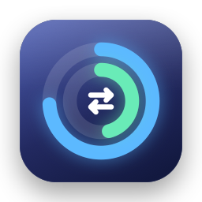
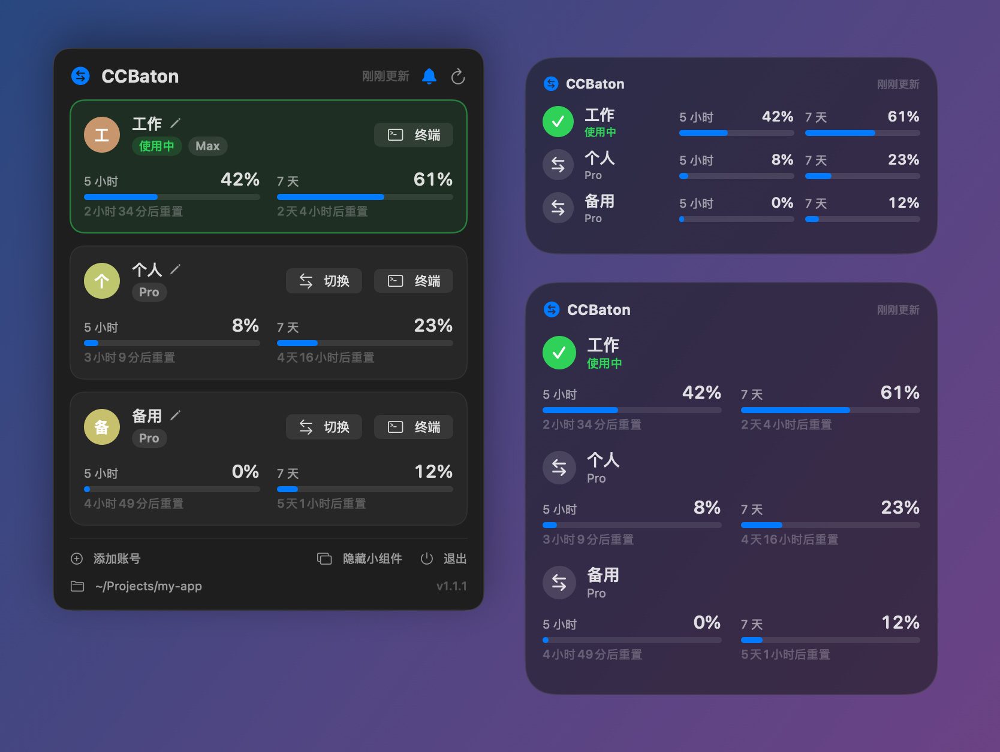
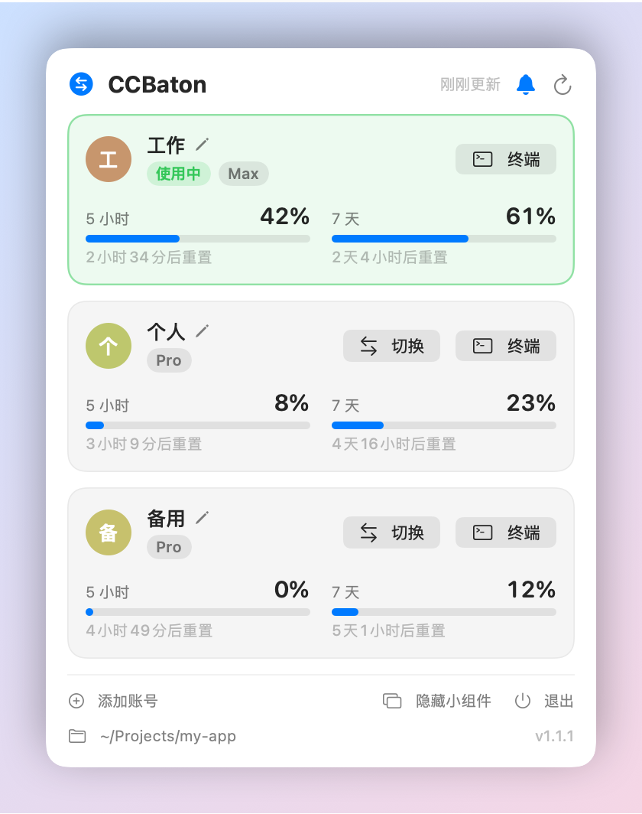
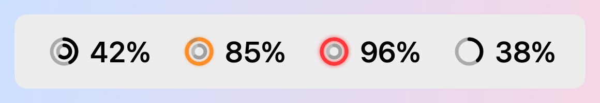
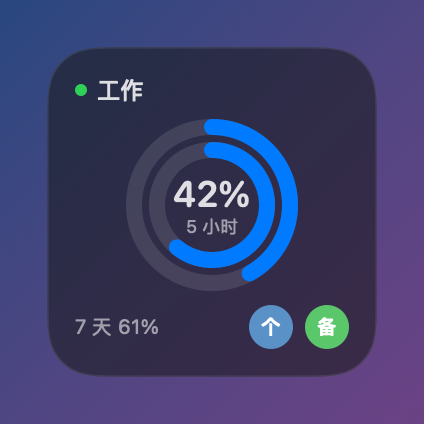
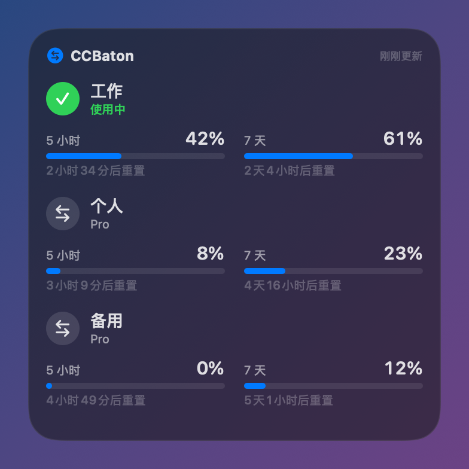
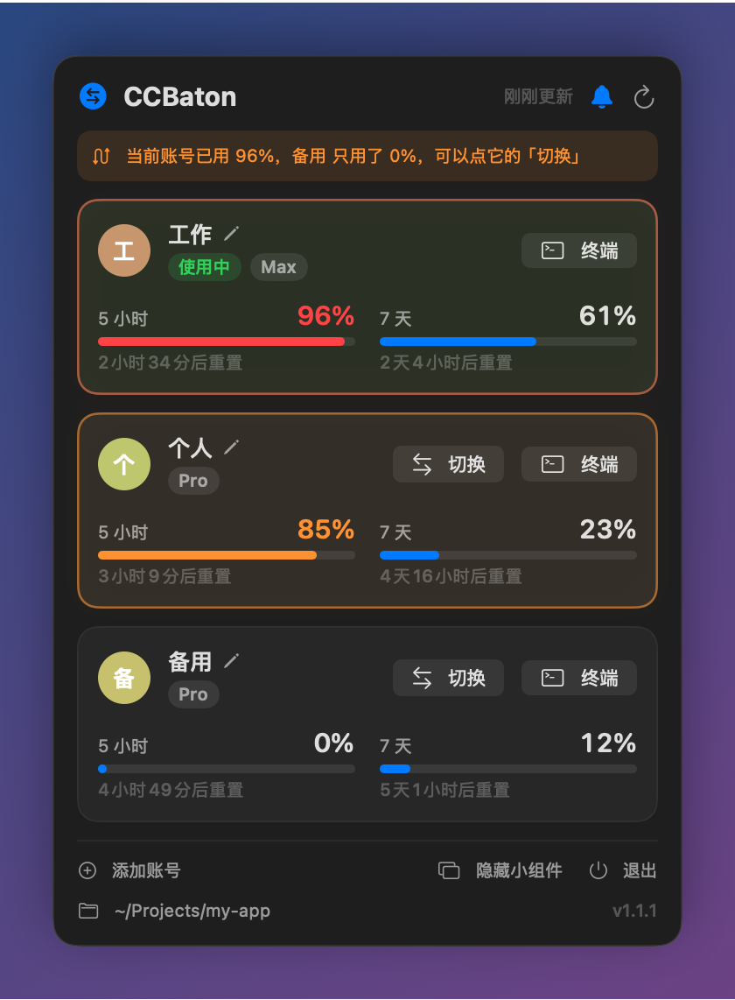
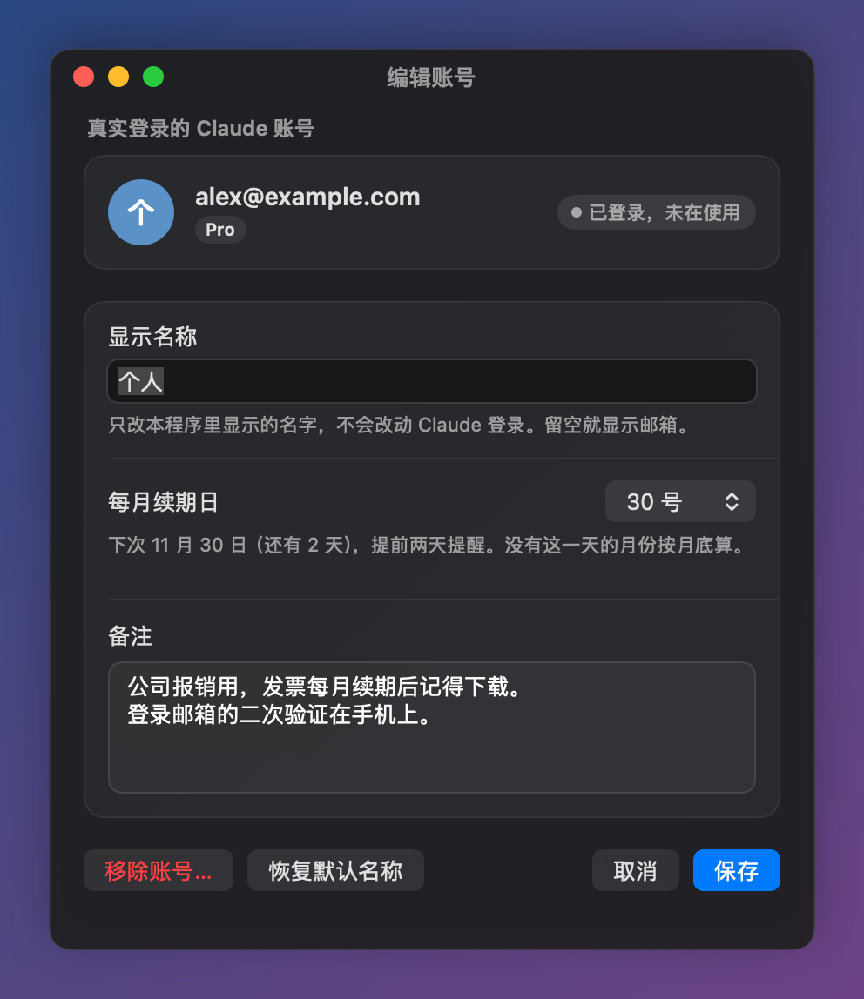

<p align="center"></p>

# CCBaton

**给 Claude Code 用的多账号接力棒。** 住在 Mac 菜单栏和桌面上，一眼看到每个账号还剩多少额度，一键换号继续干活。

*English: CCBaton is a native macOS menu-bar app and desktop widget for people who use several Claude Code subscriptions. It shows each account's 5-hour / 7-day quota, switches the account Claude Code is signed in with in one click, opens an isolated terminal per account, and warns you before a quota runs out. Swift, no dependencies, MIT licensed. Unofficial — not affiliated with Anthropic.*

> 当前版本 **1.1.1**（版本号在 `VERSION` 文件里，面板右下角也能看到）　·　[下载安装包](https://github.com/SoKeiKei/ccbaton/releases/latest)

---

## 能做什么

| 功能 | 说明 |
|---|---|
| 看额度 | 每个账号的 5 小时额度、7 天额度、多久后重置 |
| 一键切换 | 把 Claude Code 登录的账号换掉。新开的和正在运行的 `claude` 下一条消息起都用新账号 |
| 独立终端 | 每个账号都能单独开终端，三个账号三个终端，互不影响 |
| 额度告警 | 用量吃紧时变橙、告急时变红，带淡淡的光晕；快用完时弹一条系统通知 |
| 桌面小组件 | 贴在桌面上，尺寸和位置对齐系统小组件，账号前面直接有切换按钮 |
| 改名 | 给账号起个好认的名字（比如"工作""个人"），不会改动真实登录 |
| 导入 cc-switch | 一键把 [cc-switch](https://github.com/farion1231/cc-switch) 里已有的账号接过来 |

---

## 界面预览

> 截图里的账号、邮箱和用量都是演示用的虚构数据。

<p align="center"></p>

### 菜单栏面板

点菜单栏右上角的图标弹出。每个账号一张卡片，绿色边框的是"使用中"；点"切换"换号，点"终端"用这个账号独立开终端。

<table>
  <tr>
    <td align="center" valign="top" width="50%"><br><sub><b>深色</b></sub></td>
    <td align="center" valign="top" width="50%"><br><sub><b>浅色</b></sub></td>
  </tr>
</table>

菜单栏图标是双环：**外圈 5 小时，内圈 7 天**。用量吃紧时变橙、告急时变红，带淡淡的光晕（下面分别是 42% / 85% / 96%）：

<table>
  <tr>
    <td align="center" valign="top" width="50%"><br><sub><b>深色菜单栏</b></sub></td>
    <td align="center" valign="top" width="50%"><br><sub><b>浅色菜单栏</b></sub></td>
  </tr>
</table>

### 桌面小组件

三种尺寸，和系统小组件的尺寸一致；拖动时会自动吸附到系统小组件的格子上。账号前面的圆形按钮点一下就切换。

<table>
  <tr>
    <td align="center" valign="top"><br><sub><b>小号</b><br>只看使用中的账号</sub></td>
    <td align="center" valign="top"><br><sub><b>中号</b><br>每个账号一行</sub></td>
    <td align="center" valign="top"><br><sub><b>大号</b><br>带重置倒计时</sub></td>
  </tr>
</table>

### 额度告警

使用中的账号用到 96%（红），另一个账号 85%（橙）：面板顶部会建议切到还有空的账号，卡片和小组件的边沿有一圈光晕，告急时光晕会缓慢"呼吸"。

<table>
  <tr>
    <td align="center" valign="top" rowspan="2" width="50%"><br><sub><b>面板</b></sub></td>
    <td align="center" valign="top" width="50%"><br><sub><b>中号小组件</b></sub></td>
  </tr>
  <tr>
    <td align="center" valign="top"><br><sub><b>小号小组件</b></sub></td>
  </tr>
</table>

### 修改显示名称

点名字旁边的铅笔。上半部分是这个账号真实登录的 Claude 信息，下半部分填你想显示的名字（留空就显示邮箱）：

<p align="center"></p>

---

## 安装和打开

要求：macOS 14 或更高（Apple 芯片和 Intel 都支持），装好 Claude Code（终端里能运行 `claude`）。

### 方式一：下载安装包（推荐）

1. 打开 [Releases 页面](https://github.com/SoKeiKei/ccbaton/releases/latest)，下载 `CCBaton-版本号-macos.zip`，双击解压，把 `CCBaton.app` 拖进"应用程序"文件夹。
2. **第一次打开会被 macOS 拦住**，提示"无法验证开发者"或"Apple 无法检查其是否包含恶意软件"。这是因为这是个人开发的免费工具，没有购买 Apple 的开发者账号做"公证"，不是程序有问题。放行一次就行：
   - 先双击打开一次（会被拦）→ 打开"系统设置 → 隐私与安全性"→ 滚到底，找到 CCBaton 那一行 → 点"仍要打开"，输入密码。
   - 或者在终端运行一行命令，去掉下载时系统打的"来自网络"标记：
     ```
     xattr -dr com.apple.quarantine /Applications/CCBaton.app
     ```
3. 想确认下载的文件没被改过：把 Releases 里的 `.sha256` 文件和 zip 放在同一个文件夹，终端运行 `shasum -a 256 -c CCBaton-版本号-macos.zip.sha256`，显示 `OK` 就对了。

> 不放心的话，源码全部公开，可以自己看、自己编译（方式二）。

### 方式二：自己编译

需要装 Xcode 命令行工具（终端运行 `xcode-select --install`），几十秒就编完：

```
git clone https://github.com/SoKeiKei/ccbaton.git CCBaton
cd CCBaton
./build.sh
open build/CCBaton.app
```

自己编译的版本没有"来自网络"标记，不会被拦。

- 它没有 Dock 图标，打开后菜单栏右上角会出现一个**双环图标**（外圈是 5 小时额度，内圈是 7 天额度）。
- 想开机自动启动：系统设置 → 通用 → 登录项 → 点 `+` → 选 `CCBaton.app`。

---

## 日常使用

### 菜单栏面板
点菜单栏的图标，弹出面板：

- **每个账号一张卡片**：头像、名字、套餐、5 小时和 7 天用量。绿色的"使用中"标签表示 Claude Code 现在登录的就是它。
- **切换**：点卡片上的"切换"按钮，立刻换号。
- **终端**：点"终端"，用这个账号开一个新终端并启动 `claude`。
- **铅笔**（名字旁边）：修改显示名称。窗口上半部分会显示这个账号真实登录的 Claude 邮箱和套餐，下半部分填你想显示的名字，留空就显示邮箱。
- **右键卡片**：修改显示名称 / 从列表移除（只是从列表里去掉，不会删登录）。
- **顶部**：铃铛是告警开关（右键可以发一条测试提醒），圆箭头是手动刷新额度。
- **底部**：添加账号、导入 cc-switch、显示/隐藏小组件、退出，还有"打开终端时进入哪个文件夹"（点一下可以改）。

### 添加新账号
点"添加账号" → 会打开终端，走 Claude 官方的登录流程，在浏览器里授权 → 授权完回到菜单栏点刷新。

### 额度什么时候更新
程序开着时，每分钟读一次最新数据，每个账号最多每 10 分钟让 Claude 自己查一次额度（这个查询不消耗额度，也不会让 Claude 回答任何问题）。想马上更新就点刷新。

---

## 桌面小组件

点面板底部的"显示小组件"。

- **三种尺寸**：在小组件上右键选"小号 / 中号 / 大号"，和系统小组件的尺寸一致。
  - 小号：只显示"使用中"的账号（双环），右下角其他账号的头像，点头像就切换
  - 中号：每个账号一行，前面是切换按钮（灰色圆形 = 点一下切换，绿色对勾 = 正在使用）
  - 大号：每个账号一块，带重置倒计时
- **拖动**：按住空白处拖，松手时会自动吸附到系统小组件的格子上。位置和尺寸会记住。
- 右键还能"刷新额度"和"隐藏小组件"。

---

## 额度告警

| 用量 | 表现 |
|---|---|
| 80% 以上 | 橙色：进度条和百分数变橙，卡片边沿一圈淡淡的橙光 |
| 95% 以上 | 红色：变红，边沿红光会缓慢"呼吸"（系统开了"减弱动态效果"就不呼吸） |

菜单栏图标到 80% 以上也会变色，外圈带一层光晕。

**系统通知**：只提醒"正在使用"的账号，每个重置周期里最多两次——用到 90% 一次，用完一次。通知里会告诉你多久后重置，并建议切到还有空的账号。点面板里的铃铛可以关掉。第一次弹通知时，macOS 可能会问你要不要允许。

---

## 切换是怎么回事（请读一下）

Claude Code 同一时间只认一个登录。CCBaton 的做法和 cc-switch 一样：

- 每个账号有自己的目录和钥匙串条目，"正在使用"的那个账号的登录放在 Claude Code 默认读的位置。
- 点"切换"时，把目标账号的登录**移**进默认位置，原来的账号收回它自己的位置。登录令牌始终只在 macOS 钥匙串里，用系统自带的 `security` 命令搬动，**CCBaton 自己的文件里不存任何令牌**。
- 为了安全：搬动前会拿 Claude Code 自己的刷新锁、每次写入后读回核对、写之前确认没被 Claude Code 改动过；任何一步失败就取消，不留半截状态。切换前还会把原来的整份登录备份到钥匙串（条目名 `ClaudeAccountBar-backup`，每次覆盖）。

**要知道的几点：**

1. 正在运行的 `claude` 会在**下一条消息**换成新账号，提示缓存要重建，第一条会慢一点、多用一点额度。
2. 某个账号如果正用"终端"按钮单独开着，之后它被切成"使用中"，那个终端里的登录会失效（令牌只留一份）。需要的话在那个终端里重新 `/login`。
3. **不要同时在 cc-switch 里点"启用"**，两个工具一起搬登录会打架。
4. 没在使用的账号，登录大约 7～8 天到期。程序开着时会定期让 Claude 自己刷新，通常能续上；长期不开程序可能过期，过期了卡片会提示，点"重新登录"即可。
5. Anthropic 官方没有讲过这种"搬登录"的用法，cc-switch 自己也这么说，属于灰色地带。多个账号请都是你自己的订阅。CCBaton **不做自动轮换**，每次切换都是你主动点的。

---

## 数据在哪里

| 内容 | 位置 |
|---|---|
| 设置（账号列表、名字、小组件位置和尺寸、告警开关） | `~/Library/Application Support/ClaudeAccountBar/accounts.json` |
| 新加账号的目录 | `~/Library/Application Support/ClaudeAccountBar/accounts/` |
| 登录令牌 | macOS 钥匙串（`Claude Code-credentials…`），**不在文件里** |
| 切换前的备份 | 钥匙串条目 `ClaudeAccountBar-backup` |
| 从 cc-switch 导入的账号 | 仍然在 `~/.cc-switch/claude-accounts/`（只登记路径，没复制） |

> 数据目录名保留了旧名字 `ClaudeAccountBar`，是为了改名时不用搬家。

CCBaton 本身不联网，不收集任何数据。查额度的网络请求是 Claude 自己发的。

## 出问题怎么办

- **切换时提示钥匙串超时**：系统可能弹了一个钥匙串授权窗，点"始终允许"后再试。没切成功时默认登录是原样不动的。
- **卡片提示"登录已失效"**：点"重新登录"，在终端里完成授权。
- **切换后 `claude` 说没登录**：先在终端运行 `claude auth login` 重新登录，最省事。切换前的整份登录备份在钥匙串条目 `ClaudeAccountBar-backup` 里（用"钥匙串访问"app 能看到）。
- **看不到小组件**：面板底部点"显示小组件"。如果你有多个显示器，它可能在另一块屏幕上。
- **额度显示"—"或"暂无数据"**：点刷新，等几秒。
- **想彻底卸载**：退出程序 → 删除 `CCBaton` 文件夹和上面的数据目录。钥匙串里的登录不会被删（它们本来就是 Claude 的登录）。

---

## 给开发者

### 目录
```
CCBaton/
├── VERSION            版本号（只在这里改）
├── build.sh           编译并打包成 build/CCBaton.app（UNIVERSAL=1 编通用版）
├── package.sh         打发布用的压缩包 dist/CCBaton-版本-macos.zip 和校验码
├── Resources/         应用图标 AppIcon.icns
├── tools/make-icon.swift  生成应用图标的脚本（改图标就改它）
├── docs/              README 用的图片
├── README.md
└── Sources/
    ├── Core.swift       数据、账号列表、额度读取、模型
    ├── Switcher.swift   切换登录的引擎（钥匙串、锁、日志、恢复）
    ├── UI.swift         菜单栏面板、菜单栏图标、截图工具、命令行入口
    ├── Widget.swift     桌面小组件
    ├── Editor.swift     修改显示名称的窗口
    ├── Alerts.swift     额度告警：等级、光晕、通知
    ├── Driver.swift     自动驾驶测试（沙盒里模拟一通乱点）
    └── SelfTest.swift   切换引擎的沙盒自检
```

### 编译
```
cd CCBaton
./build.sh
```
发新版：先改 `VERSION`，运行 `./package.sh` 打包（通用版 + 校验码），再到 GitHub 创建 Release 上传 `dist/` 里的两个文件。

### 命令行参数
以下用 `./build/CCBaton.app/Contents/MacOS/CCBaton` 运行：

| 参数 | 作用 |
|---|---|
| `--version` | 打印版本号 |
| `--dump` | 打印读到的账号状态（只读） |
| `--check` | 对每个账号做"能不能切换"的预检（只读，不写任何东西） |
| `--snapshot 目录` | 把面板、小组件、编辑窗口、图标渲染成 PNG（只读，不需要屏幕录制权限） |
| `--readme-shots 目录` | 用虚构的演示数据渲染 README 里的截图（只读，不含任何真实信息） |
| `--import` | 导入 cc-switch 的账号 |
| `--alerttest` | 告警逻辑测试（纯计算，不发通知） |
| `--selftest` / `--widgettest` / `--renametest` | 沙盒测试，**必须**设 `CAB_TEST_ROOT` |

沙盒测试的用法（假账号、假钥匙串条目名带 `CABTEST`，完全不碰真实登录）：
```
T=$(mktemp -d)
CAB_TEST_ROOT=$T ./build/CCBaton.app/Contents/MacOS/CCBaton --selftest
rm -rf "$T"
```

`--snapshot`、`--check`、`--dump` 是只读模式：不会自动刷新额度，也绝不会写设置文件。

**自动驾驶测试**（排查布局、动画类崩溃用）：让真实运行的程序自己去点菜单栏图标、切换小组件尺寸、显示/隐藏小组件、刷新数据，跑 45 秒，崩了会返回非 0。只能在沙盒里跑：
```
T=$(mktemp -d)
CAB_TEST_ROOT=$T CAB_DRIVE=1 ./build/CCBaton.app/Contents/MacOS/CCBaton
rm -rf "$T"
```
可选环境变量：`CAB_DRIVE_SECONDS=20` 缩短时长；`CAB_DRIVE_SKIP=click,resize,toggle,data` 关掉某类操作做"排除法"。运行时屏幕上会有面板弹出收起、小组件变化。

---

## 许可证与声明

- 代码以 [MIT 许可](LICENSE) 开源。
- 切换引擎参考了 [cc-switch](https://github.com/farion1231/cc-switch)（MIT）的设计思路，详见 [NOTICE.md](NOTICE.md)。
- **这是个人开发的非官方工具，与 Anthropic 没有关联。** "Claude"、"Claude Code" 是 Anthropic, PBC 的商标。
- 使用风险自负：本工具会读写 Claude Code 在 macOS 钥匙串里的登录信息，请先读上面"切换是怎么回事"。

---

## 版本记录

### 1.1.1（2026-11-24）
**修复崩溃**：反复切换小组件尺寸、显示/隐藏小组件时，程序可能崩溃（AppKit 报"Update Constraints in Window pass"布局死循环异常）。原因是 SwiftUI 的承载视图直接当窗口的内容视图时，会在窗口布局通知里自己调整窗口大小，和程序手动调整窗口大小互相触发。现在改成在窗口里套一层普通 AppKit 容器视图，并让承载视图不参与窗口的约束布局。已用"自动驾驶测试"复现并验证（修复前 4 秒内必崩，修复后连续 45 秒、点图标 25 次、换尺寸 37 次、显示/隐藏 13 次无崩溃）。**1.1.0 的用户请升级。**

- README 截图重新排版：加了总览大图，分项截图统一成带说明的表格

### 1.1.0（2026-11-24）
- 新增应用图标（双环 + 互换箭头，生成脚本在 `tools/make-icon.swift`）
- 提供预编译安装包（通用版，Apple 芯片和 Intel 都能用）和 SHA-256 校验码
- 一律按 macOS 14 为目标编译，确认最低系统要求；二进制里不再带本机源码路径
- README 增加界面截图（用虚构的演示数据生成，`--readme-shots`）

### 1.0.0（2026-11-24）
首个正式版，改名 CCBaton。

- 菜单栏面板：三个账号的 5 小时 / 7 天额度、一键切换、独立终端、改名、添加账号、导入 cc-switch
- 切换引擎：参考 cc-switch 的思路用 Swift 重写，带刷新锁、写后读回校验、切换前备份、崩溃后补完
- 桌面小组件：小 / 中 / 大三种尺寸，对齐系统小组件格子并自动吸附，账号前直接切换
- 额度告警：橙 / 红两级光晕，菜单栏图标光晕，到 90% 和用完时的系统通知
- 动效：面板弹出和卡片依次浮现、小组件淡入淡出、换尺寸的弹簧变形、进度条数值过渡
- 菜单栏图标：双环，随用量变色
