<p align="center"></p>

# CCBaton

**给 Claude Code 用的多账号接力棒。** 住在 Mac 菜单栏和桌面上，一眼看到每个账号还剩多少额度，一键换号继续干活。

*English: CCBaton is a native macOS menu-bar app and desktop widget for people who use several Claude Code subscriptions. It shows each account's 5-hour / 7-day quota, switches the account Claude Code is signed in with in one click, opens a terminal per account with a directory picker and launch options (shielded from third-party API settings; optional full isolation from account switching), warns you before a quota runs out, updates itself in one click from signed GitHub releases, and can optionally (off by default) start idle accounts' 5-hour windows early, staggered so they reset at different times. Swift, no dependencies, MIT licensed. Unofficial — not affiliated with Anthropic.*

> 当前版本 **1.3.1**　·　[下载安装包](https://github.com/SoKeiKei/ccbaton/releases/latest)　·　macOS 14 或更高

<p align="center"></p>

<p align="center"><sub>图里是"快用完"时的样子：顶部建议换号（带"切换"按钮），96% 红色告警、85% 橙色告警，底部一行是额度预热状态（预热默认关闭，开启后才有这一行）。<br>本页截图里的账号、邮箱和用量都是虚构的演示数据。</sub></p>

---

## 能做什么

| 功能 | 说明 |
|---|---|
| [看额度](#菜单栏面板) | 每个账号的 5 小时额度、7 天额度、多久后重置 |
| [一键切换](#菜单栏面板) | 换掉 Claude Code 登录的账号。新开的和正在运行的普通 `claude`，下一条消息起都用新账号 |
| [额度告警](#额度告警) | 用量吃紧变橙、告急变红，面板顶部建议换号；快用完时弹系统通知 |
| [打开终端](#打开终端) | 给某个账号单独开终端：现选目录、可加启动参数；可选"完全独立"，切换账号也不影响它 |
| [额度预热](#额度预热) | 账号空闲时自动让 5 小时倒计时先走起来，并错开各账号的重置时间（默认关） |
| [桌面小组件](#桌面小组件) | 三种尺寸，对齐系统小组件，账号前面直接有切换按钮 |
| [账号再多也放得下](#账号多的时候) | 面板自动换紧凑布局，小组件大小不变；顺序由你拖动决定 |
| [账号管理](#账号管理) | 添加账号、改显示名称、写备注、彻底移除账号 |
| [续期提醒](#续期提醒和备注) | 填上每月续期日，到期前两天起在面板和小组件上提醒（默认不填、不提醒） |
| [从 cc-switch 迁过来](#从-cc-switch-迁过来) | 导入在 [cc-switch](https://github.com/farion1231/cc-switch) 里登录过的 Claude 账号，还可以把它们的文件迁到 CCBaton 自己的目录，不用重新登录 |
| [设置窗口](#设置窗口) | 开机启动、预热、提醒、小组件集中在一处 |
| [软件更新](#软件更新) | 有新版时版本号前亮红点，点一下自动下载安装，只装签名对得上的包 |

**1.3.1 新增**：[续期提醒和账号备注](#续期提醒和备注)。

**1.3.0 新增**：[一键更新](#软件更新)、[多账号布局和拖动排序](#账号多的时候)、[额度预热](#额度预热)、[设置窗口](#设置窗口)、开终端前先选目录和参数并做好[账号隔离](#账号是怎么隔开的)。完整列表见[版本记录](#版本记录)。

---

## 安装和打开

要求：macOS 14 或更高（Apple 芯片和 Intel 都支持），装好 Claude Code（终端里能运行 `claude`）。

### 方式一：下载安装包（推荐）

1. 打开 [Releases 页面](https://github.com/SoKeiKei/ccbaton/releases/latest)，下载 `CCBaton-版本号-macos.dmg`，双击打开，把 `CCBaton` 拖到旁边的"应用程序"上，然后弹出这个磁盘。（同一页面的 zip 是给软件自动更新用的，不用下载。）
2. **第一次打开会被 macOS 拦住**，提示"无法验证开发者"或"Apple 无法检查其是否包含恶意软件"。这是因为这是个人开发的免费工具，没有购买 Apple 的开发者账号做"公证"，不是程序有问题。放行一次就行：
   - 先双击打开一次（会被拦）→ 打开"系统设置 → 隐私与安全性"→ 滚到底，找到 CCBaton 那一行 → 点"仍要打开"，输入密码。
   - 或者在终端运行一行命令，去掉下载时系统打的"来自网络"标记：
     ```
     xattr -dr com.apple.quarantine /Applications/CCBaton.app
     ```
3. 想确认下载的文件没被改过：把 Releases 里对应的 `.sha256` 文件和 dmg 放在同一个文件夹，终端运行 `shasum -a 256 -c CCBaton-版本号-macos.dmg.sha256`，显示 `OK` 就对了。

装好以后的新版本可以在软件里[一键更新](#软件更新)。1.2.0 及更早的版本没有这个功能，需要照上面手动装一次（装之前先在面板里点"退出"，运行中的程序没法替换）。

> 不放心的话，源码全部公开，可以自己看、自己编译（方式二）。

### 方式二：自己编译

需要装 Xcode 命令行工具（终端运行 `xcode-select --install`），几十秒就编完：

```
git clone https://github.com/SoKeiKei/ccbaton.git CCBaton
cd CCBaton
./build.sh
open build/CCBaton.app
```

自己编译的版本没有"来自网络"标记，不会被拦。

它没有 Dock 图标，打开后菜单栏右上角会出现一个**双环图标**。想开机自动启动，见[设置窗口](#设置窗口)。

---

## 菜单栏面板

点菜单栏右上角的图标弹出。

<table>
  <tr>
    <td align="center" valign="top" width="50%">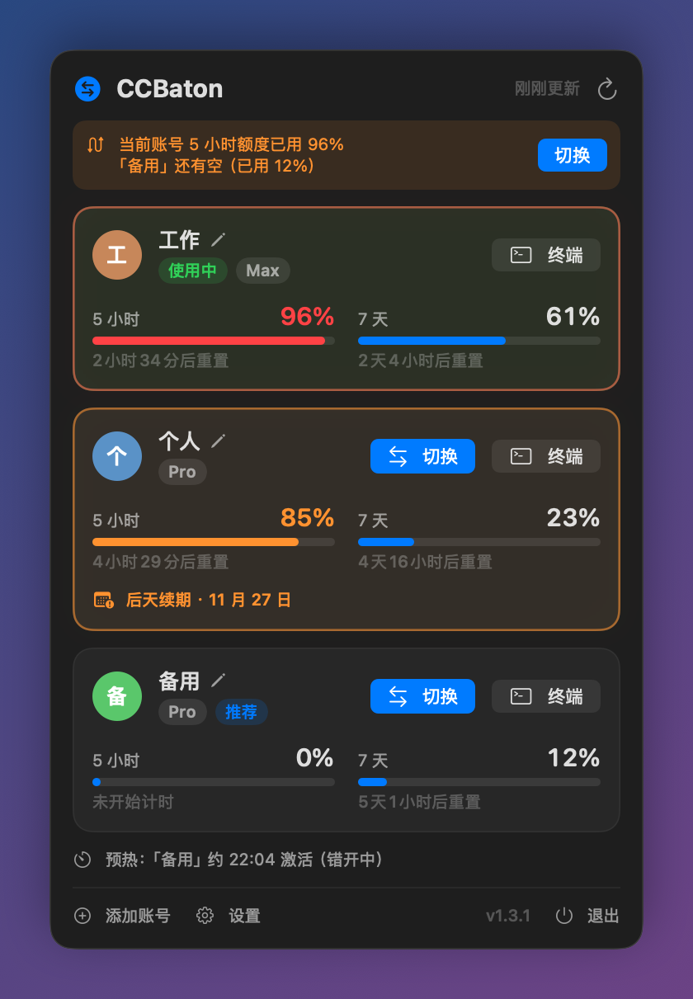<br><sub><b>深色</b></sub></td>
    <td align="center" valign="top" width="50%"><br><sub><b>浅色</b></sub></td>
  </tr>
</table>

从上到下：

- **顶部**：数据更新时间，圆箭头手动刷新额度。
- **换号建议**：使用中的账号 5 小时或 7 天额度到 90% 以上才出现。有比较空的账号时点名推荐，建议条上直接点"切换"，那个账号上也会标"推荐"。"比较空"指 5 小时和 7 天里更高的那个低于 70%。
- **账号卡片**：头像、名字、套餐、5 小时和 7 天用量、重置倒计时（还没开始计时的显示"未开始计时"）。带"使用中"标签的，就是 Claude Code 现在登录的账号。
  - **切换**：立刻换号。如果会影响开着的终端，先弹窗问你。
  - **终端**：选好目录和参数，用这个账号开终端，见[打开终端](#打开终端)。
- **预热状态**：开了额度预热才有，点一下打开设置。
- **底部**：添加账号、设置、版本号、退出。

### 账号多的时候

5 个以内都是大卡片。**6 个起**自动换成紧凑布局：使用中的账号还是大卡片，其他每个一行。账号多到超出屏幕时，中间部分可以滚动。

<table>
  <tr>
    <td align="center" valign="top" width="50%">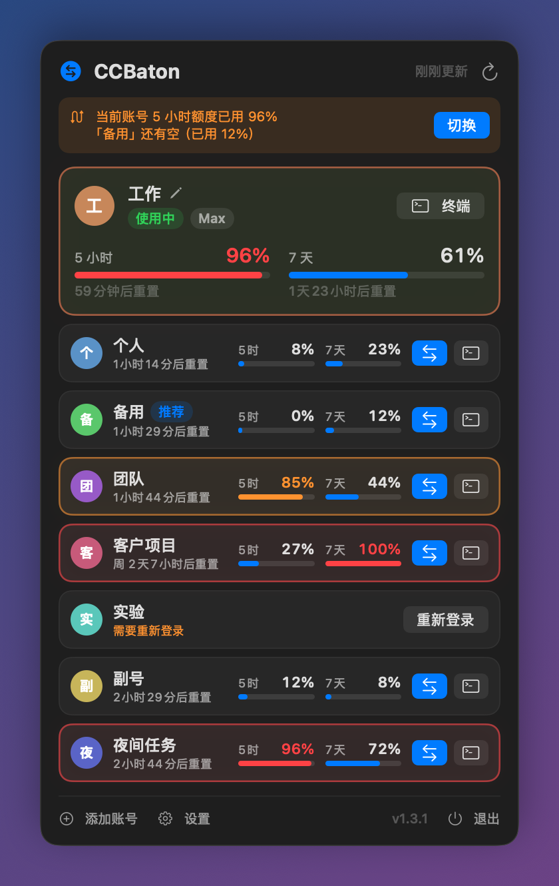<br><sub><b>8 个账号</b>（带换号建议和"推荐"）</sub></td>
    <td align="center" valign="top" width="50%">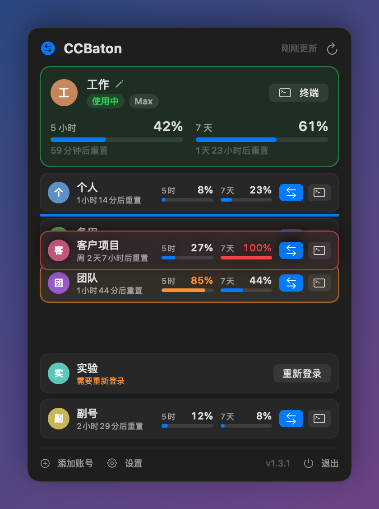<br><sub><b>拖动排序</b>（蓝线是松手后的位置）</sub></td>
  </tr>
</table>

- **顺序由你决定**：按住账号拖动，或右键选"上移 / 下移 / 移到最前"。程序不会自己挪账号的位置，使用中的账号也留在原位，只是高亮。新添加的账号排在最后。
- 紧凑行里两个蓝色图标分别是"切换"和"终端"。鼠标停在名字上能看到套餐和两个重置时间；改名、写备注用右键。
- 每个账号有固定的头像颜色，调整顺序后不变。

菜单栏图标是双环：**外圈 5 小时，内圈 7 天**。用量吃紧时变橙、告急时变红，带淡淡的光晕（下面分别是 42% / 85% / 96%）：

<table>
  <tr>
    <td align="center" valign="top" width="50%"><br><sub><b>深色菜单栏</b></sub></td>
    <td align="center" valign="top" width="50%"><br><sub><b>浅色菜单栏</b></sub></td>
  </tr>
</table>

**额度什么时候更新**：程序开着时每分钟读一次最新数据，每个账号最多每 10 分钟让 Claude 自己查一次额度（这个查询不消耗额度，也不会让 Claude 回答任何问题）。想马上更新就点刷新。

---

## 额度告警

看 5 小时和 7 天里更高的那个：

| 用量 | 表现 |
|---|---|
| 80% 以上 | 橙色：进度条和百分数变橙，卡片和小组件边沿一圈淡淡的橙光 |
| 95% 以上 | 红色：变红，边沿红光会缓慢"呼吸"（系统开了"减弱动态效果"就不呼吸） |

菜单栏图标到 80% 以上也会变色，外圈带一层光晕。面板上的样子见本页开头的大图，小组件上是这样：

<table>
  <tr>
    <td align="center" valign="middle">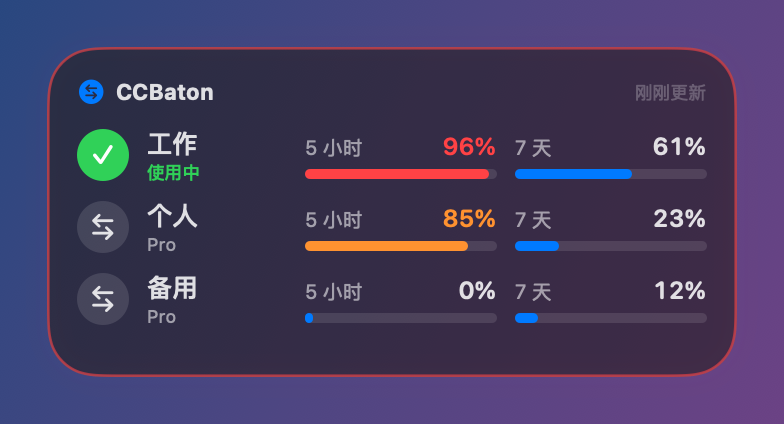<br><sub><b>中号小组件</b></sub></td>
    <td align="center" valign="middle">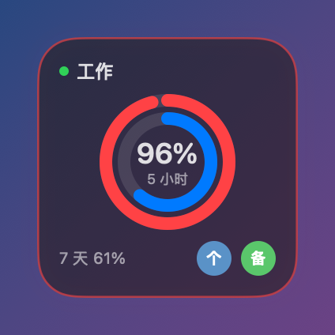<br><sub><b>小号小组件</b></sub></td>
  </tr>
</table>

**系统通知**：只提醒"使用中"的账号。5 小时和 7 天分开算，每个重置周期最多两次：用到 90% 一次，用完一次。通知里会告诉你多久后重置，并建议切到还有空的账号。可以在设置里关掉。第一次弹通知时，macOS 可能会问你要不要允许。

---

## 打开终端

点账号卡片上的"终端"，先弹出这个窗口：

<p align="center">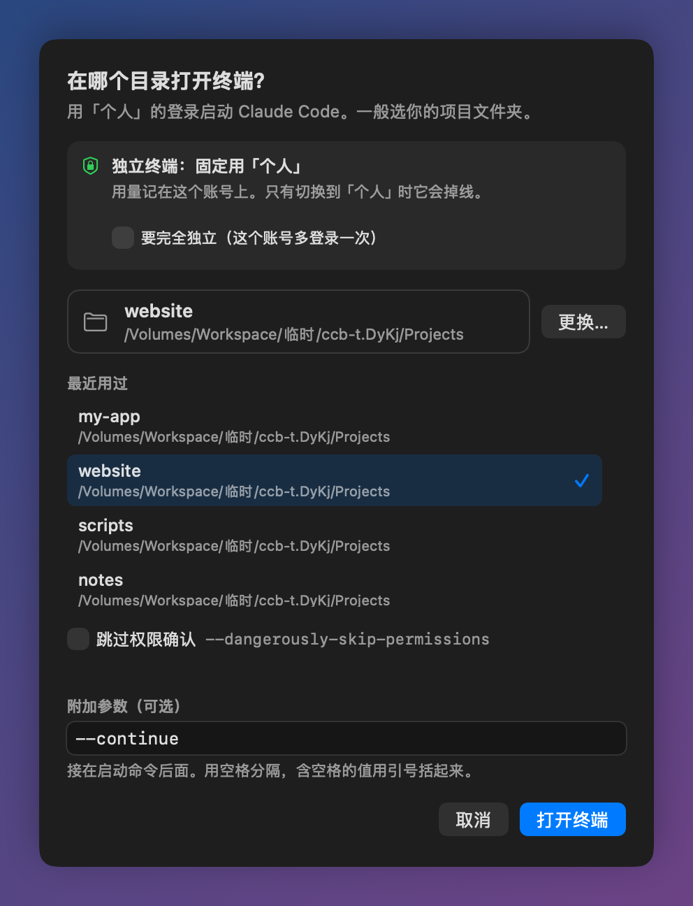</p>

- **选目录**：点"更换…"挑一个文件夹，或点"最近用过"里的一条（最多记 10 个，各账号共用；鼠标移上去可以删掉记录，不会删文件夹）。
- **各记各的**：每个账号记住自己上次用的目录、"跳过权限确认"和附加参数，下次点开直接按回车就行。
- **跳过权限确认**：勾上等于加 `--dangerously-skip-permissions`，Claude 改文件、执行命令都不再问你。勾选状态会记住，打开前留意一下。
- **附加参数**：比如 `--continue`、`--model opus`。按空格分开，含空格的值用引号括起来；参数原样传给 `claude`，不会被终端当成别的命令执行。`--settings` 不能填，它会破坏账号隔离。
- **工作环境是共用的**：agents、skills、命令、插件、`CLAUDE.md`、设置和对话记录都链接到你的 `~/.claude`，默认配置里的 MCP 服务器也会带过去，所以换个账号可以用 `claude --resume` 接着聊。（从 cc-switch 导入的账号，目录归 cc-switch 管，见下面的说明。）

### 账号是怎么隔开的

默认**不用再登录**，沿用每个账号现有的登录（和 cc-switch 一样）。窗口顶部会说明当前是哪种情况：

| 情况 | 终端用哪份登录 | 之后切换账号时 |
|---|---|---|
| 账号没在使用 | 账号自己的 | 切到别的账号不受影响；**切到它本身时这个终端掉线** |
| 账号正在使用 | 默认位置的 | **跟着换号** |
| 勾了"要完全独立" | 终端专用的一份（多登录一次） | 完全不受影响 |

如果开着的终端会被某次切换影响，CCBaton 会先弹窗告诉你影响几个，由你决定（只认得出从 CCBaton 打开的终端）。

不管哪种情况，都会做这几层防护：

- **挡住别的接口**：终端配置（`.zshrc` 等）里的 API 密钥、接口地址、令牌、Bedrock / Vertex 开关会被清掉；用户设置和项目设置里的同类项（包括 cc-switch 换到第三方供应商写进去的）用 `claude --settings` 覆盖掉。**不改你的任何设置文件**。第三方顺带设置的模型名环境变量也一并忽略，要指定模型就在附加参数里写 `--model`。
- **核对账号**：启动前检查要用的那份登录确实是所选账号，不是就不启动。
- **例外**：公司下发的系统级管理设置优先级最高，如果它指定了接口，CCBaton 会拒绝打开终端。

"完全独立"第一次打开时在终端里走一次官方登录（浏览器授权，登录页预填好邮箱；授权成了别的账号不会启动），以后不用再勾。程序开着时每 12 小时给它续期一次（只查额度，不花额度）。每个项目第一次用它打开时 Claude 会问一次是否信任。

从 cc-switch 导入、还没[迁移](#从-cc-switch-迁过来)的账号，它的目录里有一份 cc-switch 生成的设置副本，CCBaton 不去改它。用默认方式（没勾"完全独立"）给这类账号开的终端读的是这份副本：你改了默认设置后，要 cc-switch 同步过才会带过去。迁移之后就改用默认设置了。

---

## 额度预热

**默认关闭，开启前请读完。**

Claude 的 5 小时额度要等你发出第一条消息才开始计时。几个账号平时闲着、要用时一起开始，就会差不多同时用完，然后一起等重置。开启预热后：

- 某个账号一空闲（没有在计时），CCBaton 就让 `claude` 给它发一条极短的消息（Haiku 模型，不带工具、插件和你的设置，不保存对话），倒计时随即开始。同时有几个空闲时，先激活 7 天额度剩得多的。
- **错开**（默认开）：两次激活至少隔 5 小时 ÷ 能预热的账号数。3 个账号就是 1 小时 40 分，排开之后每隔这么久就有一个账号重置。急着用某个账号时直接用就行，不受限制。
- 发之前会先重新读额度确认它真的空闲；发完一两分钟后再核对倒计时有没有开始。没成功的 30 分钟后重试，连续失败 3 次后 5 小时才试一次。读不到最新额度（比如断网）时不发。
- 7 天额度已用完、登录失效的账号不会发。

现在轮到谁、几点激活，面板底部和设置窗口里都看得到。

**要知道的几点：**

1. **消耗额度**：每次约 630 token（按 API 价约 0.00013 美元），每个账号一天最多激活约 5 次。很少，但不是零。
2. **周额度不会变多**：能连续干活的时间长了，7 天额度也烧得更快。
3. **电脑睡眠或程序没开时不会激活**，唤醒后才补上。
4. **有账号风险**：Anthropic 的[消费者条款](https://www.anthropic.com/legal/consumer-terms)限制用脚本等自动方式访问服务（API 密钥或官方明确允许的情况除外），[Claude Code 法律页](https://code.claude.com/docs/en/legal-and-compliance)说订阅额度按"普通的个人使用"设定。这个功能走的是官方 `claude -p`，但官方没有明确说定时自动激活是否允许。是否开启请自己判断，风险自负。
5. 需要较新版本的 Claude Code（支持 `--safe-mode`）。

---

## 桌面小组件

在设置里打开"显示小组件"。

<table>
  <tr>
    <td align="center" valign="top"><br><sub><b>小号</b><br>只看使用中的账号</sub></td>
    <td align="center" valign="top">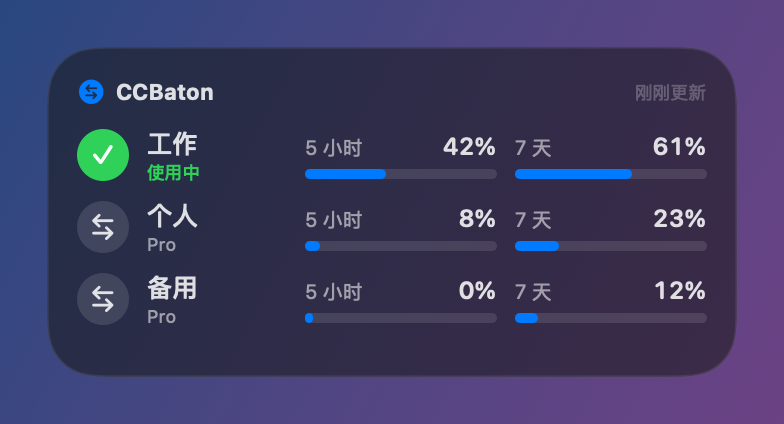<br><sub><b>中号</b><br>每个账号一行</sub></td>
    <td align="center" valign="top"><br><sub><b>大号</b><br>带重置倒计时</sub></td>
  </tr>
</table>

<p align="center">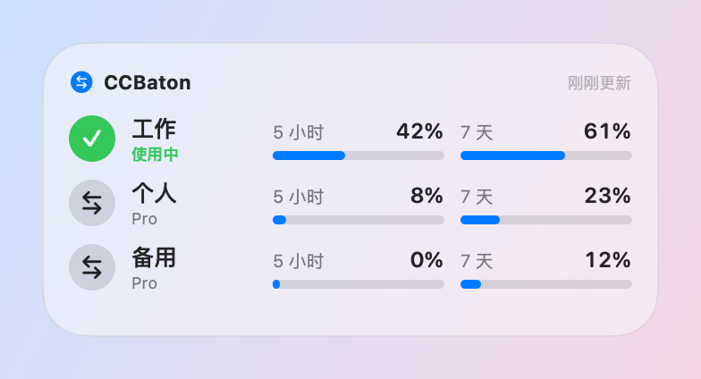<br><sub>浅色模式</sub></p>

- **切换账号**：中号和大号点账号前面的圆形按钮（灰色 = 点一下切换，绿色对勾 = 正在使用）；小号点右下角其他账号的头像。
- **换尺寸**：右键选"小号 / 中号 / 大号"，和系统小组件的尺寸一致。
- **拖动**：按住空白处拖，松手时自动吸附到系统小组件的格子上。位置和尺寸会记住。
- 右键还能"刷新额度"、打开"设置"和"隐藏小组件"。

**账号多的时候，小组件大小不变**，仍然对齐系统格子：

| 尺寸 | 原来的样子 | 账号更多时 | 还放不下时 |
|---|---|---|---|
| 小号 | 1～4 个 | 5 个起：两个头像加 "+N" | 点 "+N" 选 |
| 中号 | 1～3 个 | 4～6 个：两列排 | 7 个起：5 个加"还有 N 个" |
| 大号 | 1～3 个 | 4～8 个：每个一行（不显示重置时间） | 9 个起：7 个加"还有 N 个" |

放不下时按你排的顺序显示前几个；使用中的账号如果排在后面，会占最后一个位置，保证一直看得到。点"+N"或"还有 N 个"弹出菜单，选一个直接切换。

<p align="center">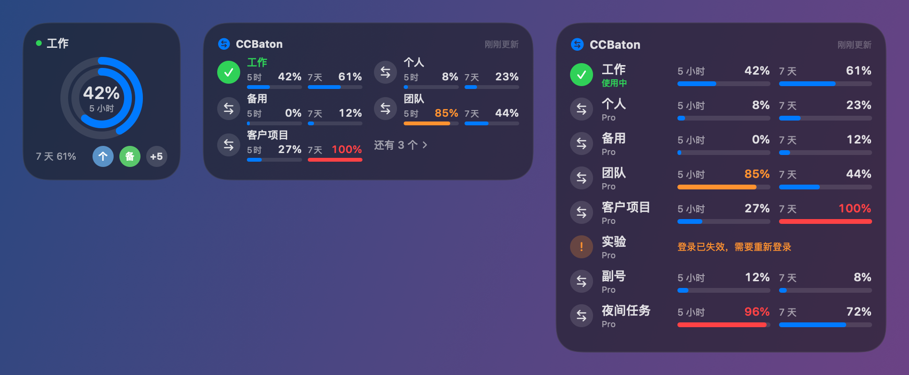<br><sub>8 个账号时的小号、中号、大号</sub></p>

---

## 设置窗口

面板底部点"设置"（小组件右键也能打开）。

<p align="center">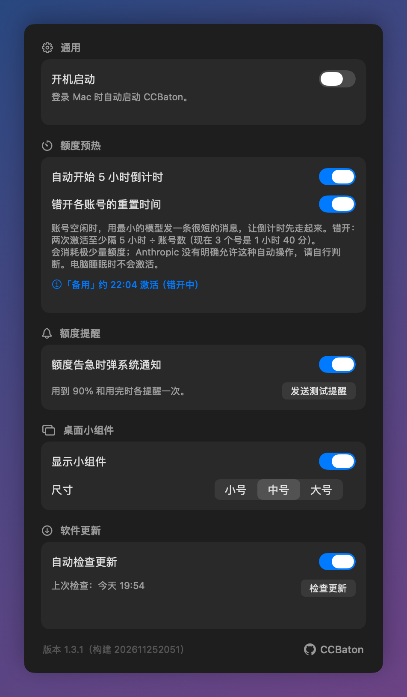</p>

| 分组 | 里面有什么 |
|---|---|
| 通用 | 开机启动；装着 cc-switch 且有账号还没导入时，多一行"导入在 cc-switch 里登录的账号" |
| 账号文件位置 | 只在有账号的文件还在 cc-switch 目录里时出现：[迁移到 CCBaton](#从-cc-switch-迁过来) |
| 额度预热 | 总开关、错开重置时间、当前状态 |
| 额度提醒 | 系统通知开关、发送测试提醒 |
| 桌面小组件 | 显示 / 隐藏、尺寸 |
| 软件更新 | 自动检查开关、检查更新、更新到新版本，见[软件更新](#软件更新) |

窗口最底部左边是版本号，右边的 GitHub 图标加"CCBaton"点开本项目的开源仓库。

**开机启动**用的是 macOS 正规的登录项，在"系统设置 → 通用 → 登录项"里也能看到、能关。

- 请先把 `CCBaton.app` 放进"应用程序"文件夹再开启。放在外接盘或下载文件夹里的话，开机时那个位置可能还没准备好，会悄悄启动失败。
- 第一次开启时，系统可能会弹一条"已添加登录项"的提示，或者要你到"系统设置 → 通用 → 登录项"里点一下允许。

---

## 软件更新

<table>
  <tr>
    <td align="center" valign="top" width="50%">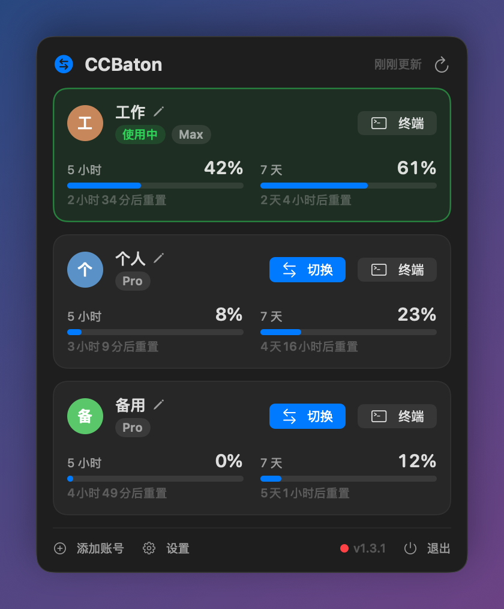<br><sub><b>有新版时版本号前亮红点</b></sub></td>
    <td align="center" valign="top" width="50%">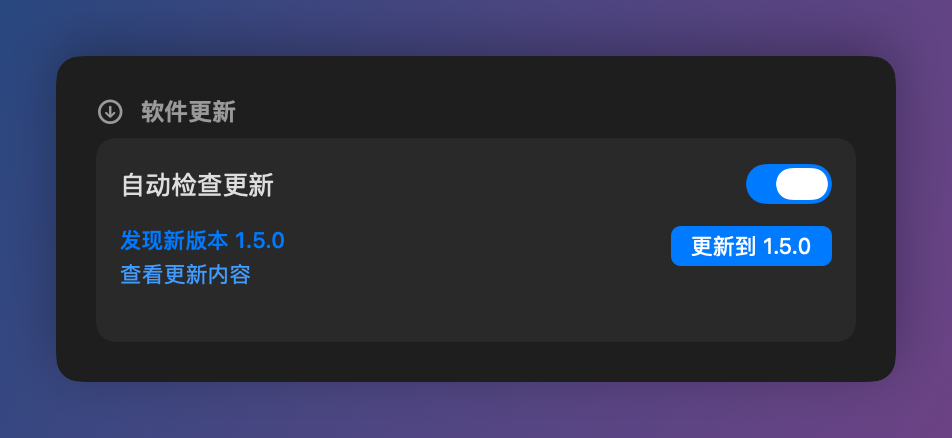<br><sub><b>设置里一键更新</b></sub></td>
  </tr>
</table>

- **自动检查**（默认开）：开机后查一次，之后每天最多一次；没查成（比如刚开机没网）10 分钟后再试。也可以随时点"检查更新"。
- **更新**：点"更新到 x.x.x"后才下载安装，不会自己偷偷装。下载 → 核对签名和版本号 → 退出 → 换上新版 → 重新打开。账号和设置不受影响。
- **装坏了会退回**：新版一分钟内没有启动起来，自动换回旧版。
- **安全**：只安装用本项目发布钥匙签过名的安装包，下载地址只认 github.com。签名对不上、版本号对不上、或比现在旧，都不装。
- 软件要放在"应用程序"里才能更新（直接从 DMG 里打开的不行）。连不上 GitHub 时可以点"打开下载页面"手动装。

---

## 账号管理

- **添加账号**：面板底部点"添加账号"，名字可填可不填 → 点"在终端里登录"，走 Claude 官方的登录流程，在浏览器里授权 → 授权完回到菜单栏点刷新。
- **导入 cc-switch**：见[从 cc-switch 迁过来](#从-cc-switch-迁过来)。
- **重新登录**：登录失效的账号，卡片上会出现"重新登录"按钮。
- **调整顺序**：拖动，或右键"上移 / 下移 / 移到最前"。面板和小组件都按这个顺序排。
- **编辑账号**：点名字旁边的铅笔（或右键账号选"编辑账号…"）。上面是这个账号真实登录的 Claude 信息，下面可以填显示名称（比如"工作""个人"，留空就显示邮箱）、每月续期日和备注。不会改动真实登录。

<p align="center"></p>

### 续期提醒和备注

- **每月续期日**：默认"不提醒"。选了几号之后，到期前两天起提醒（后天续期 → 明天续期 → 今天续期），过了当天自动轮到下个月。那个月没有这一天（比如 2 月选了 31 号）按月底算。
- **提醒在哪里**：面板的账号卡片底部显示"后天续期 · 几月几日"，紧凑布局里写在名字下面；小组件上账号名下面或旁边显示橙色文字，小号小组件里其他账号的头像带一个橙点。
- 只是按你填的日期提醒，CCBaton 不知道实际有没有续费，也不弹系统通知。
- **备注**：自己随便写（比如付款方式、用途），回车换行，点"保存"后存下来，只保存在这台电脑上。

### 移除账号

右键账号选"移除账号…"，或点铅笔后按左下角的按钮。使用中的账号不能移除，先切换到别的账号。

移除就是**彻底移除**，不管这个账号是怎么加进来的。确认前会弹一个警告框（取消键是 Esc，回车不会触发移除）：

<p align="center">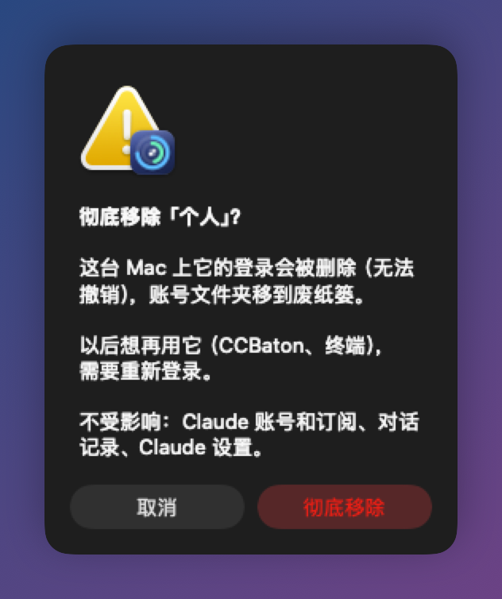</p>

| 内容 | 怎么处理 |
|---|---|
| 钥匙串里它的登录（含备份副本和"完全独立"终端那份） | 删除，**无法撤销**，以后要用得重新登录 |
| 它的账号文件夹 | 移到废纸篓 |
| cc-switch 记录里它那一条（导入的账号） | 删掉这一条，改之前把原清单备份到本程序数据目录的 `backups/` |
| cc-switch 的数据库 | 不动 |

对话记录、技能、Claude 设置（链接到 `~/.claude` 的那些）、Claude 账号和订阅都不受影响。

> 导入的账号和 cc-switch 共用同一份登录：在这里移除，cc-switch 里也会失效。还在用 cc-switch 的话，请先退出它再移除；它的数据库里可能留下一个指向空账号的条目。

## 从 cc-switch 迁过来

分两步，都在设置窗口里。相关入口只在需要时出现：没装 cc-switch、或账号已经迁完，界面里就不显示它。

1. **导入**：点"导入在 cc-switch 里登录的账号"。这一步只登记账号目录，不复制任何令牌，两个工具共用同一份登录。
2. **迁移**（可选，想让账号由 CCBaton 单独管理时做）：先退出 cc-switch，再点"迁移到 CCBaton"。登录和账号文件搬进 CCBaton 自己的目录，**不用重新登录**，迁走的账号在 cc-switch 里不再出现。

<table>
  <tr>
    <td align="center" valign="top" width="50%">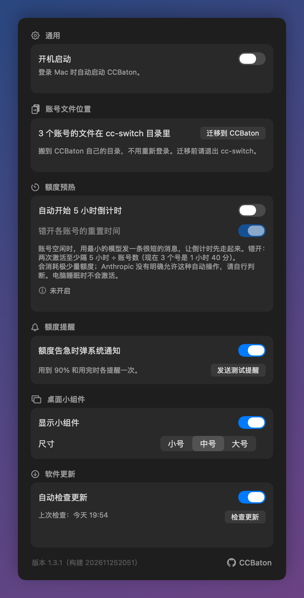<br><sub><b>入口</b></sub></td>
    <td align="center" valign="top" width="50%">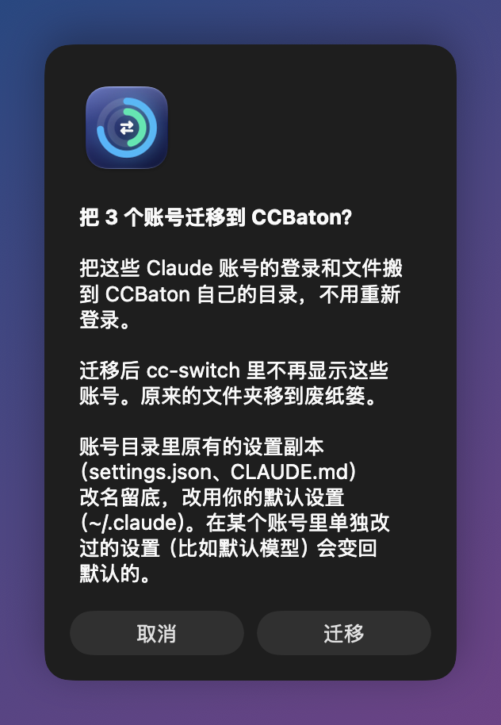<br><sub><b>确认框</b></sub></td>
  </tr>
</table>

迁移时做了什么：

- 先把账号目录和钥匙串里的登录**复制**到新位置并读回核对，账号列表确认写进磁盘后，才删掉旧的。中途任何一步失败，复制出来的撤掉，旧的原样不动；中途断电，下次启动自动收尾。
- 账号的名字、顺序、颜色、终端偏好、命令历史都保留。
- cc-switch 的账号记录里删掉迁走的条目（改之前备份），旧账号文件夹移到废纸篓。cc-switch 的数据库不动。
- 账号目录里原有的 `settings.json`、`CLAUDE.md` 副本改名为 `*.from-cc-switch` 留底，改用你 `~/.claude` 里的默认设置。**在某个账号里单独改过的设置（比如默认模型）会变回默认的。**

这些情况下不会开始迁移，会告诉你原因：cc-switch 还开着、有终端或别的程序正在用这些账号目录、CCBaton 正在切换或读额度。

---

## 切换是怎么回事（请读一下）

Claude Code 同一时间只认一个登录。CCBaton 的做法和 cc-switch 一样：

- 每个账号有自己的目录和钥匙串条目，"正在使用"的那个账号的登录放在 Claude Code 默认读的位置。
- 点"切换"时，把目标账号的登录**移**进默认位置，原来的账号收回它自己的位置。登录令牌始终只在 macOS 钥匙串里，用系统自带的 `security` 命令搬动，**CCBaton 自己的文件里不存任何令牌**。
- 为了安全：搬动前会拿 Claude Code 自己的刷新锁、每次写入后读回核对、写之前确认没被 Claude Code 改动过；任何一步失败就取消，不留半截状态。切换前还会把原来的整份登录备份到钥匙串（条目名 `ClaudeAccountBar-backup`，每次覆盖）。

**要知道的几点：**

1. 正在运行的普通 `claude`（包括跟着默认登录的终端）会在**下一条消息**换成新账号，提示缓存要重建，第一条会慢一点、多用一点额度。
2. 从"终端"按钮开的终端可能受切换影响（见[账号是怎么隔开的](#账号是怎么隔开的)），受影响时会先提醒你。
3. **不要同时在 cc-switch 里点"启用"**，两个工具一起搬登录会打架。
4. 没在使用的账号，登录大约 7～8 天到期。程序开着时会定期让 Claude 自己刷新，通常能续上；长期不开程序可能过期，过期了卡片会提示，点"重新登录"即可。
5. Anthropic 官方没有讲过这种"搬登录"的用法，cc-switch 自己也这么说，属于灰色地带。多个账号请都是你自己的订阅。CCBaton **不做自动轮换**，每次切换都是你主动点的（唯一会自动发消息的是默认关闭的[额度预热](#额度预热)）。

---

## 数据在哪里

| 内容 | 位置 |
|---|---|
| 设置（账号列表和顺序、名字、续期日、备注、头像颜色、小组件位置和尺寸、告警开关、预热开关和记录、最近目录和启动参数） | `~/Library/Application Support/ClaudeAccountBar/accounts.json` |
| 新加账号的目录 | `~/Library/Application Support/ClaudeAccountBar/accounts/` |
| 登录令牌 | macOS 钥匙串（`Claude Code-credentials…`），**不在文件里** |
| "完全独立"终端的目录 | `~/Library/Application Support/ClaudeAccountBar/terminals/` |
| 切换前的备份 | 钥匙串条目 `ClaudeAccountBar-backup` |
| 从 cc-switch 导入的账号 | 迁移前仍在 `~/.cc-switch/claude-accounts/`（只登记路径，没复制）；迁移后和新加的账号放在一起 |
| 移除或迁移账号时备份的 cc-switch 记录（不含令牌） | `~/Library/Application Support/ClaudeAccountBar/backups/` |
| 更新时下载的安装包和记录（更新成功后清掉安装包） | `~/Library/Application Support/ClaudeAccountBar/update/` |

> 数据目录名保留了旧名字 `ClaudeAccountBar`，是为了改名时不用搬家。

CCBaton 自己只在检查和下载更新时联网（访问 GitHub，请求里只带软件名和版本号；自动检查可以在设置里关掉），不收集、不上传任何账号数据。查额度（以及开启后的预热消息）的网络请求是 Claude 自己发的。

## 出问题怎么办

- **切换时提示钥匙串超时**：系统可能弹了一个钥匙串授权窗，点"始终允许"后再试。没切成功时默认登录是原样不动的。
- **卡片提示"登录已失效"**：点"重新登录"，在终端里完成授权。
- **切换后 `claude` 说没登录**：先在终端运行 `claude auth login` 重新登录，最省事。切换前的整份登录备份在钥匙串条目 `ClaudeAccountBar-backup` 里（用"钥匙串访问"app 能看到）。
- **从"终端"按钮开的终端说没登录**：多半是之后切换到了这个账号，登录搬到默认位置了。关掉它，重新点"终端"。
- **终端提示"没有启动 claude"**：开窗口到启动之间登录变了，或"完全独立"授权成了别的账号。按终端里的说明处理后再点一次。
- **看不到小组件**：打开设置里的"显示小组件"。如果你有多个显示器，它可能在另一块屏幕上。
- **额度显示"—"或"暂无数据"**：点刷新，等几秒。
- **预热状态显示"上次没成功"**：在终端运行 `claude --version` 确认 Claude Code 是新版本，并确认这个账号能正常使用。
- **导入的账号突然都失效了**：没[迁移](#从-cc-switch-迁过来)的账号文件放在 `~/.cc-switch` 里，这个文件夹被删除或移动后就读不到了，需要重新添加账号。
- **迁移提示"有正在运行的程序在用"**：把别处打开的 `claude`（比如从 cc-switch 开的终端）关掉再试。
- **更新没成功**：设置里"软件更新"会说明原因；脚本的记录在上面 `update/` 目录的 `install.log`。也可以到下载页面手动装。
- **想彻底卸载**：先在设置里关掉"开机启动" → 退出程序 → 删除 `CCBaton.app`（自己编译的删源码文件夹）和上面的数据目录。钥匙串里的登录不会被删（它们本来就是 Claude 的登录）。

---

## 给开发者

### 目录
```
CCBaton/
├── VERSION            版本号（只在这里改）
├── build.sh           编译并打包成 build/CCBaton.app（UNIVERSAL=1 编通用版）
├── package.sh         打发布文件到 dist/：dmg（给人下载）、zip 和签名（给自动更新）、校验码
├── Resources/         应用图标 AppIcon.icns
├── tools/make-icon.swift  生成应用图标的脚本（改图标就改它）
├── tools/release-key.swift 发布钥匙：生成、签名、备份
├── docs/              README 用的图片
├── README.md
└── Sources/
    ├── Core.swift       数据、账号列表、额度读取、模型
    ├── Switcher.swift   切换登录的引擎（钥匙串、锁、日志、恢复）
    ├── UI.swift         菜单栏面板、菜单栏图标、截图工具、命令行入口
    ├── Widget.swift     桌面小组件
    ├── Accounts.swift   账号多时的规则：紧凑布局、拖动排序、推荐、小组件放不下时显示谁
    ├── AccountsTest.swift 多账号界面和移除账号的测试
    ├── Removal.swift    移除账号：删哪些、警告框写什么
    ├── Migration.swift  把存放在 cc-switch 目录里的账号文件搬进本程序目录
    ├── MigrationTest.swift 迁移的测试
    ├── Editor.swift     编辑账号的窗口
    ├── Renewal.swift    续期提醒的日期计算
    ├── Alerts.swift     额度告警：等级、光晕、通知
    ├── Warmup.swift     额度预热：什么时候激活哪个账号、发消息、核对
    ├── WarmupTest.swift 预热的测试（含模拟和假 claude）
    ├── Settings.swift   设置窗口
    ├── Terminal.swift   打开终端：选目录和启动参数的窗口
    ├── Isolation.swift  独立终端的账号隔离
    ├── TerminalTest.swift 打开终端的测试
    ├── Driver.swift     自动驾驶测试（沙盒里模拟一通乱点）
    ├── LoginItem.swift  开机启动（系统登录项）
    ├── Update.swift     软件更新：检查、核对签名、替换自己、失败退回
    ├── UpdateTest.swift 更新的测试
    └── SelfTest.swift   切换引擎的沙盒自检
```

### 编译
```
cd CCBaton
./build.sh
```
### 发布新版
1. 改 `VERSION` 和下面的版本记录。
2. 运行 `./package.sh`。签名时系统会弹窗询问是否允许读取发布钥匙，点"允许"。
3. 在 GitHub 创建 Release，**标签必须是 `v版本号`**，把脚本列出的 5 个文件全部传上去（dmg、zip、zip.sig 和两个 sha256）。少了 zip 或 sig，软件里只能提示手动下载。

**发布钥匙**只存在发布者电脑的钥匙串里（软件里写的是对应的公钥）。请备份一份放到安全的地方：`swift tools/release-key.swift export <文件>`，换电脑用 `import` 恢复。钥匙丢了的话，已经装好的旧版没法自动更新到用新钥匙签的版本，只能手动装一次。Fork 本项目自己发版的话，要生成自己的钥匙并替换 `Sources/Update.swift` 里的公钥和下载地址。

界面改了要更新本页截图：
```
./build/CCBaton.app/Contents/MacOS/CCBaton --readme-shots docs/screenshots
```

### 命令行参数
以下用 `./build/CCBaton.app/Contents/MacOS/CCBaton` 运行：

| 参数 | 作用 |
|---|---|
| `--version` | 打印版本号 |
| `--dump` | 打印读到的账号状态（只读） |
| `--check` | 对每个账号做"能不能切换"的预检（只读，不写任何东西） |
| `--snapshot 目录` | 把面板、小组件、设置和终端窗口、编辑窗口、图标渲染成 PNG（只读，不需要屏幕录制权限） |
| `--readme-shots 目录` | 用虚构的演示数据渲染 README 里的截图（只读，不含任何真实信息） |
| `--login-item on｜off｜status` | 开启 / 关闭 / 查看开机启动（注册的是这次运行的那份 `.app`，请从"应用程序"里运行） |
| `--import` | 导入在 cc-switch 里登录的账号 |
| `--check-terminal-login 目录 账号` | 启动脚本内部用：核对独立终端登录的是不是这个账号 |
| `--check-update` | 问一次 GitHub 最新版本是多少（只读，不下载） |
| `--alerttest` | 告警逻辑测试（纯计算，不发通知） |
| `--selftest` / `--widgettest` / `--renametest` / `--warmuptest` / `--terminaltest` / `--multitest` / `--migratetest` / `--updatetest` | 沙盒测试，**必须**设 `CAB_TEST_ROOT`（`--warmuptest`、`--terminaltest` 用假的 claude，不花额度；`--widgettest`、`--multitest` 运行时屏幕上会短暂出现小窗口） |

沙盒测试的用法（假账号、假钥匙串条目名带 `CABTEST`，完全不碰真实登录）：
```
T=$(mktemp -d)
CAB_TEST_ROOT=$T ./build/CCBaton.app/Contents/MacOS/CCBaton --selftest
rm -rf "$T"
```

`--snapshot`、`--check`、`--dump` 是只读模式：不会自动刷新额度，也绝不会写设置文件。

**自动驾驶测试**（排查布局、动画类崩溃用）：让真实运行的程序自己去点菜单栏图标、切换小组件尺寸、显示/隐藏小组件、开关设置和终端窗口、增减账号、刷新数据，跑 45 秒，崩了会返回非 0。有的系统版本（如 macOS 27）里程序点不开自己的菜单栏弹窗，所以同时开一个装着同样面板内容的替身窗口。只能在沙盒里跑：
```
T=$(mktemp -d)
CAB_TEST_ROOT=$T CAB_DRIVE=1 ./build/CCBaton.app/Contents/MacOS/CCBaton
rm -rf "$T"
```
可选环境变量：`CAB_DRIVE_SECONDS=20` 缩短时长；`CAB_DRIVE_SKIP=click,resize,toggle,data,settings,count` 关掉某类操作做"排除法"；`CAB_DRIVE_DRAG=1` 改为只测拖动排序。运行时屏幕上会有面板弹出收起、小组件变化。

---

## 许可证与声明

- 代码以 [MIT 许可](LICENSE) 开源。
- 切换引擎和终端启动方式参考了 [cc-switch](https://github.com/farion1231/cc-switch)（MIT）的设计思路，详见 [NOTICE.md](NOTICE.md)。
- **这是个人开发的非官方工具，与 Anthropic 没有关联。** "Claude"、"Claude Code" 是 Anthropic, PBC 的商标。
- 使用风险自负：本工具会读写 Claude Code 在 macOS 钥匙串里的登录信息，请先读上面"切换是怎么回事"。

---

## 版本记录

### 1.3.1（2026-11-25）
- 账号可以填**每月续期日**，到期前两天起在面板和小组件上提醒（默认不提醒）
- 账号可以写**备注**
- "修改显示名称"窗口改为"编辑账号"

### 1.3.0（2026-11-25）
- **软件更新**：自动检查新版本（开机后一次，之后每天最多一次），版本号前亮红点，设置里一键下载安装；安装包要签名对得上才装，新版起不来自动退回
- 发布文件增加 DMG，打开后直接拖进"应用程序"
- **多账号界面**：面板 6 个账号起换紧凑布局，超出屏幕可滚动；小组件账号再多也保持系统格子大小，放不下的收进"+N / 还有 N 个"菜单
- **手动排序**：拖动账号，或右键"上移 / 下移 / 移到最前"
- **移除账号**改为彻底移除（删登录、账号文件夹进废纸篓、清掉 cc-switch 清单里的条目），先弹警告框；以前只是从列表里去掉，而且没有确认
- 设置窗口底部：版本号靠左，开源仓库链接靠右
- 新增**迁移到 CCBaton**：把从 cc-switch 导入的账号搬进本程序目录，不用重新登录
- cc-switch 相关的入口和说明只在装着它、且有需要时才显示
- 换号建议带"切换"按钮并标出推荐账号；**修正**：以前只看 5 小时额度，可能推荐一个 7 天额度已用完的账号；现在两个都看，7 天快用完也会提示
- 头像颜色改为固定分配，账号之间不再撞色
- 设置里"错开"的间隔按实际账号数显示
- 新增**额度预热**（默认关闭）：账号空闲时自动让 5 小时倒计时开始，可错开各账号的重置时间
- 新增**设置窗口**：开机启动、导入 cc-switch、额度提醒、小组件等从面板移到这里，面板更清爽
- **打开终端**改为先弹窗口：现选目录（记住最近用过的）、可勾"跳过权限确认"、填附加参数，每个账号各记各的；原来全局固定的终端目录取消
- **终端的账号隔离**：启动前核对账号，清掉并覆盖能让请求走别处的环境变量和设置；默认沿用现有登录，切换会影响开着的终端时先提醒；可选"完全独立"（多登录一次）
- 额度条在没开始计时时显示"未开始计时"
- 调用 `claude` 时不再把 `ANTHROPIC_*`、`CLAUDE*` 环境变量带过去

### 1.2.0（2026-11-24）
- 新增**开机启动**开关（面板右下角），用 macOS 正规的登录项接口，也提供命令行 `--login-item`
- 开启前会提醒：应用放在外接盘上时，开机可能启动失败，建议放进"应用程序"文件夹

### 1.1.1（2026-11-24）
**修复崩溃**：反复切换小组件尺寸、显示/隐藏小组件时，程序可能崩溃（AppKit 报"Update Constraints in Window pass"布局死循环异常）。原因是 SwiftUI 的承载视图直接当窗口的内容视图时，会在窗口布局通知里自己调整窗口大小，和程序手动调整窗口大小互相触发。现在改成在窗口里套一层普通 AppKit 容器视图，并让承载视图不参与窗口的约束布局。已用"自动驾驶测试"复现并验证（修复前 4 秒内必崩，修复后连续 45 秒、点图标 25 次、换尺寸 37 次、显示/隐藏 13 次无崩溃）。**1.1.0 的用户请升级。**

- README 截图重新排版：加了总览大图，分项截图统一成带说明的表格

### 1.1.0（2026-11-24）
- 新增应用图标（双环 + 互换箭头，生成脚本在 `tools/make-icon.swift`）
- 提供预编译安装包（通用版，Apple 芯片和 Intel 都能用）和 SHA-256 校验码
- 一律按 macOS 14 为目标编译，确认最低系统要求；二进制里不再带本机源码路径
- README 增加界面截图（用虚构的演示数据生成，`--readme-shots`）

### 1.0.0（2026-11-24）
首个正式版，改名 CCBaton。

- 菜单栏面板：三个账号的 5 小时 / 7 天额度、一键切换、独立终端、改名、添加账号、导入 cc-switch
- 切换引擎：参考 cc-switch 的思路用 Swift 重写，带刷新锁、写后读回校验、切换前备份、崩溃后补完
- 桌面小组件：小 / 中 / 大三种尺寸，对齐系统小组件格子并自动吸附，账号前直接切换
- 额度告警：橙 / 红两级光晕，菜单栏图标光晕，到 90% 和用完时的系统通知
- 动效：面板弹出和卡片依次浮现、小组件淡入淡出、换尺寸的弹簧变形、进度条数值过渡
- 菜单栏图标：双环，随用量变色
