# CCBaton 使用说明

这里是 CCBaton 的详细说明。只想快速了解和安装，看[首页](../README.md)就够了；用之前建议读一下[合规与风险说明](compliance.md)。

- [安装和打开](#安装和打开)
- [菜单栏面板](#菜单栏面板)
- [额度告警](#额度告警)
- [Claude 桌面端](#claude-桌面端)
- [打开终端](#打开终端)
- [额度预热](#额度预热)
- [桌面小组件](#桌面小组件)
- [设置窗口](#设置窗口)
- [软件更新](#软件更新)
- [账号管理](#账号管理)
- [从 cc-switch 迁过来](#从-cc-switch-迁过来)
- [切换是怎么回事（请读一下）](#切换是怎么回事请读一下)
- [数据在哪里](#数据在哪里)
- [出问题怎么办](#出问题怎么办)

---

## 安装和打开

要求：macOS 14 或更高（Apple 芯片和 Intel 都支持），装好 Claude Code（终端里能运行 `claude`）。

### 方式一：下载安装包（推荐）

1. 打开 [Releases 页面](https://github.com/SoKeiKei/ccbaton/releases/latest)，下载 `CCBaton-版本号-macos.dmg`，双击打开，把 `CCBaton` 拖到旁边的"应用程序"上，然后弹出这个磁盘。（同一页面的 zip 是给软件自动更新用的，不用下载。）
2. **第一次打开会被 macOS 拦住**，提示"无法验证开发者"或"Apple 无法检查其是否包含恶意软件"。这是因为这是个人开发的免费工具，没有购买 Apple 的开发者账号做"公证"，不是程序有问题。放行一次就行：
   - 先双击打开一次（会被拦）→ 打开"系统设置 → 隐私与安全性"→ 滚到底，找到 CCBaton 那一行 → 点"仍要打开"，输入密码。
   - 或者在终端运行一行命令，去掉下载时系统打的"来自网络"标记：
     ```
     xattr -dr com.apple.quarantine /Applications/CCBaton.app
     ```
3. 想确认下载的文件没被改过：把 Releases 里对应的 `.sha256` 文件和 dmg 放在同一个文件夹，终端运行 `shasum -a 256 -c CCBaton-版本号-macos.dmg.sha256`，显示 `OK` 就对了。

装好以后的新版本可以在软件里[一键更新](#软件更新)。1.2.0 及更早的版本没有这个功能，需要照上面手动装一次（装之前先在面板里点"退出"，运行中的程序没法替换）。

> 不放心的话，源码全部公开，可以自己看、自己编译（方式二）。

### 方式二：自己编译

需要装 Xcode 命令行工具（终端运行 `xcode-select --install`），几十秒就编完：

```
git clone https://github.com/SoKeiKei/ccbaton.git CCBaton
cd CCBaton
./build.sh
open build/CCBaton.app
```

自己编译的版本没有"来自网络"标记，不会被拦。

它没有 Dock 图标，打开后菜单栏右上角会出现一个**双环图标**。想开机自动启动，见[设置窗口](#设置窗口)。

---

---

## 菜单栏面板

点菜单栏右上角的图标弹出。

<table>
  <tr>
    <td align="center" valign="top" width="50%">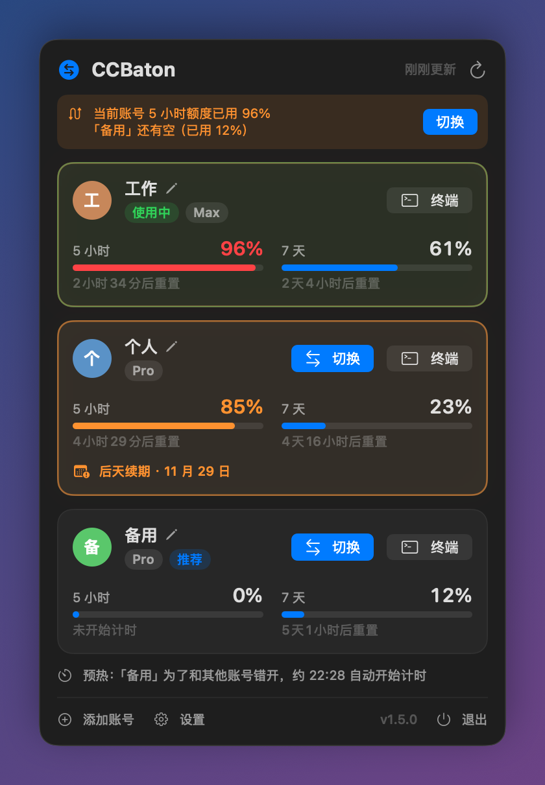<br><sub><b>深色</b></sub></td>
    <td align="center" valign="top" width="50%">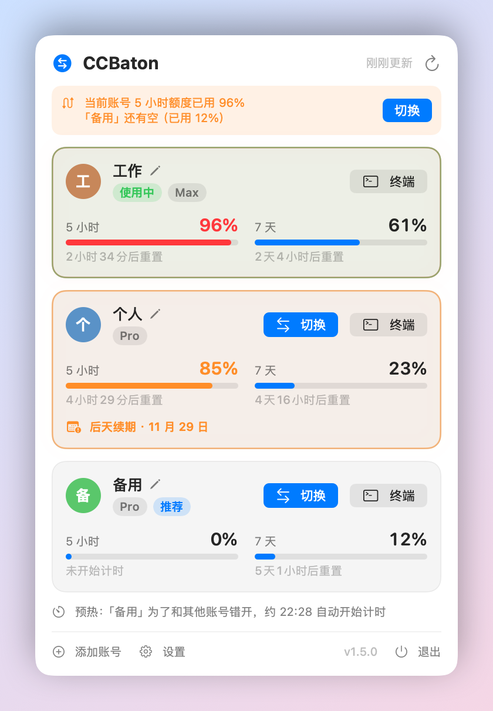<br><sub><b>浅色</b></sub></td>
  </tr>
</table>

从上到下：

- **顶部**：数据更新时间，圆箭头手动刷新额度。
- **换号建议**：使用中的账号 5 小时或 7 天额度到 90% 以上才出现。有比较空的账号时点名推荐，建议条上直接点"切换"，那个账号上也会标"推荐"。"比较空"指 5 小时和 7 天里更高的那个低于 70%。
- **账号卡片**：头像、名字、套餐、5 小时和 7 天用量、重置倒计时（还没开始计时的显示"未开始计时"）。带"使用中"标签的，就是 Claude Code 现在登录的账号。
  - **切换**：立刻换号。如果会影响开着的终端，先弹窗问你。
  - **终端**：选好目录和参数，用这个账号开终端，见[打开终端](#打开终端)。
- **预热状态**：开了额度预热才有，点一下打开设置。
- **底部**：添加账号、设置、版本号、退出。

**右键菜单栏图标**（或按住 Control 点）不用打开面板，直接弹出一个简易菜单：版本号（有新版时多一行「去更新」）、刷新额度、添加账号…、显示/隐藏桌面小组件、设置…、退出。左键点图标仍然是打开面板。

### 已用还是剩余

默认显示**已用**了多少。习惯看还剩多少的，在[设置](#设置窗口)里把"额度显示"从"已用"切到"剩余"，面板、菜单栏图标和数字、桌面小组件、换号建议和系统通知会一起换过来：进度条和圆环表示还剩的部分，面板和中号、大号小组件的标题旁标着"剩余额度"。只是换个看法，变橙、变红、提醒和推荐账号的时机都不变。

<p align="center">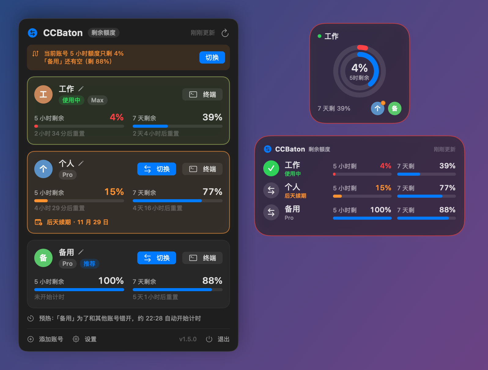<br><sub>"额度显示"选"剩余"后：96% 已用显示成剩 4%</sub></p>

### Ultra 套餐：没有 5 小时限制

2026 年 10 月 30 日起，Claude 把 Max 20x（200 美元）改名为 **Ultra**，原来的 Max 5x 改叫 Max。Ultra 的周额度是 Pro 的 10 倍，**认证过的账号没有 5 小时限制**，还没认证的账号会有临时的 5 小时限制（官方说明见 [What is the Ultra plan?](https://support.claude.com/en/articles/17728952-what-is-the-ultra-plan)）。

CCBaton 对它这样处理：

- **套餐名**：Claude Code 里它仍记作 Max，只有档位信息（`rateLimitTier`）不同，CCBaton 靠这个把 20x 档显示成 Ultra、5x 档显示成 Max。认不出的套餐照原样显示。
- **没有 5 小时窗口就不显示 5 小时**：面板卡片只留一条周额度，标"无 5 小时限制"；紧凑行、小组件、账号菜单同理；菜单栏图标变成一圈周额度，数字也是周额度。账号的 5 小时窗口里有真实用量和重置时间（还没认证）时，照常显示。
- **提醒、换号建议、预热**：只按周额度算。没有 5 小时窗口的账号没得预热，所以不参与。
- **只对 Ultra 这样处理**：别的套餐读不到 5 小时额度，仍显示"暂无数据"，免得把读取失败当成没有限制。

> **说明**：开发者手上没有 Ultra 账号，这部分是按官方说明和别人公开的配置样例做的，没有在真实的 Ultra 账号上试过。如果你的 Ultra 账号显示不对（比如套餐名不是 Ultra、还出现 5 小时那一栏、数字和 Claude 官网对不上），请到 [Issues](https://github.com/SoKeiKei/ccbaton/issues) 反馈，最好附上 `~/.claude.json` 里 `cachedUsageUtilization` 下 `five_hour`、`limits` 的内容（不含邮箱等个人信息）。

<p align="center">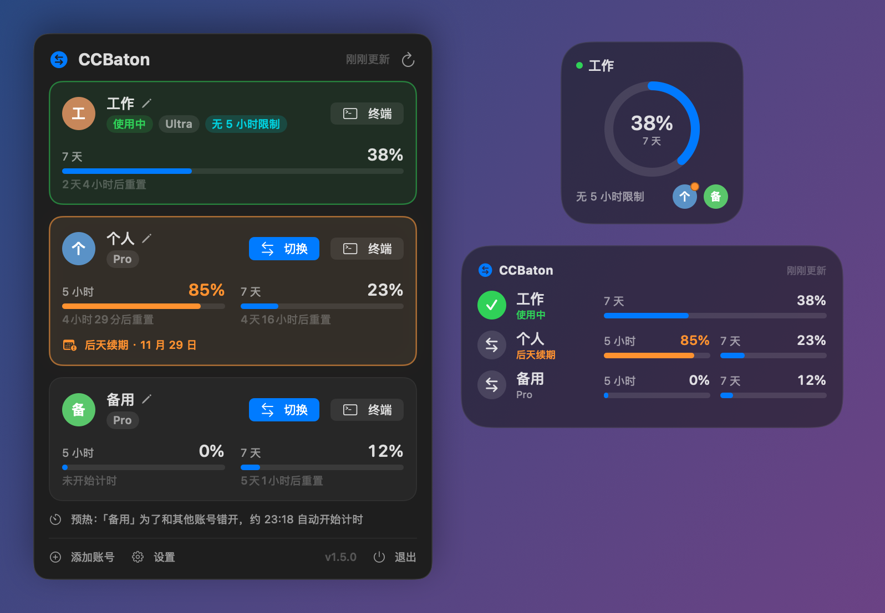<br><sub>Ultra 账号：只有周额度，没有 5 小时那一栏</sub></p>

### 账号多的时候

5 个以内都是大卡片。**6 个起**自动换成紧凑布局：使用中的账号还是大卡片，其他每个一行。账号多到超出屏幕时，中间部分可以滚动。

<table>
  <tr>
    <td align="center" valign="top" width="50%">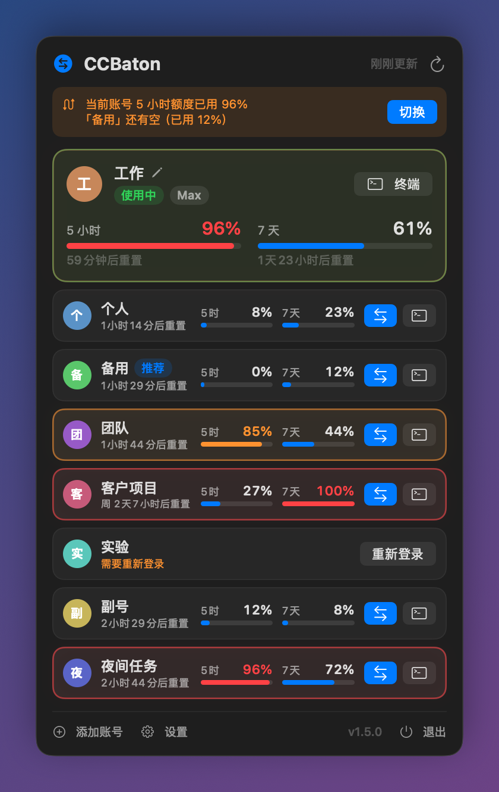<br><sub><b>8 个账号</b>（带换号建议和"推荐"）</sub></td>
    <td align="center" valign="top" width="50%">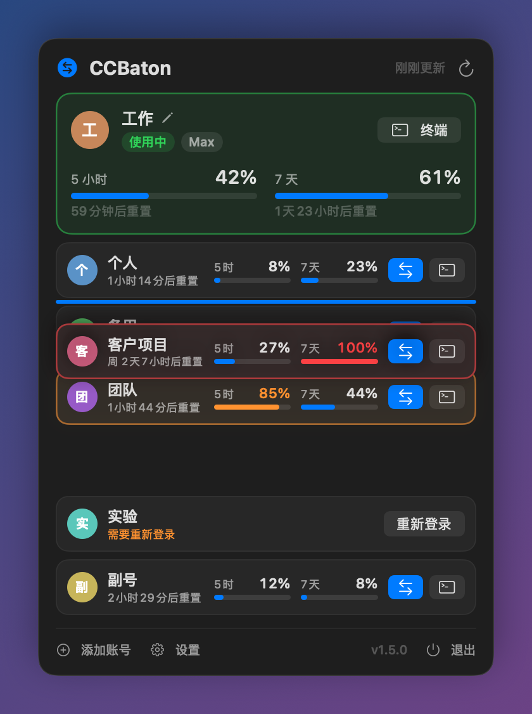<br><sub><b>拖动排序</b>（蓝线是松手后的位置）</sub></td>
  </tr>
</table>

- **顺序由你决定**：按住账号拖动，或右键选"上移 / 下移 / 移到最前"。程序不会自己挪账号的位置，使用中的账号也留在原位，只是高亮。新添加的账号排在最后。
- 紧凑行里两个蓝色图标分别是"切换"和"终端"。鼠标停在名字上能看到套餐和两个重置时间；改名、写备注用右键。
- 每个账号有固定的头像颜色，调整顺序后不变。

菜单栏图标是双环：**外圈 5 小时，内圈 7 天**。用量吃紧时变橙、告急时变红，带淡淡的光晕（下面分别是 42% / 85% / 96%；最右是[没有 5 小时限制的 Ultra](#ultra-套餐没有-5-小时限制)，只有一圈周额度）：

<table>
  <tr>
    <td align="center" valign="top" width="50%">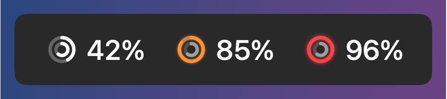<br><sub><b>深色菜单栏</b></sub></td>
    <td align="center" valign="top" width="50%">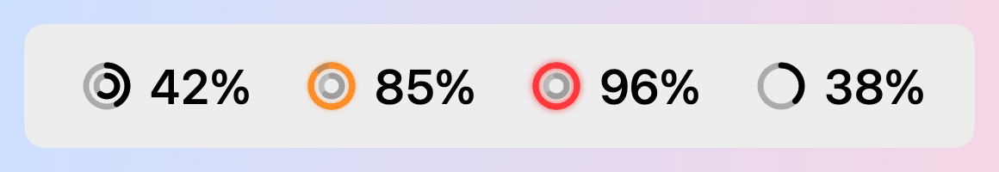<br><sub><b>浅色菜单栏</b></sub></td>
  </tr>
</table>

**额度什么时候更新**：程序开着时每分钟读一次最新数据，每个账号最多每 10 分钟让 Claude 自己查一次额度（这个查询不消耗额度，也不会让 Claude 回答任何问题）。想马上更新就点刷新。

---

---

## 额度告警

看 5 小时和 7 天里更高的那个（下面按已用来说；[额度显示选"剩余"](#已用还是剩余)时，对应剩 20% 和 5% 以内）：

| 用量 | 表现 |
|---|---|
| 80% 以上 | 橙色：进度条和百分数变橙，卡片和小组件边沿一圈淡淡的橙光 |
| 95% 以上 | 红色：变红，边沿红光会缓慢"呼吸"（系统开了"减弱动态效果"就不呼吸） |

菜单栏图标到 80% 以上也会变色，外圈带一层光晕。面板上的样子见本页开头的大图，小组件上是这样：

<table>
  <tr>
    <td align="center" valign="middle">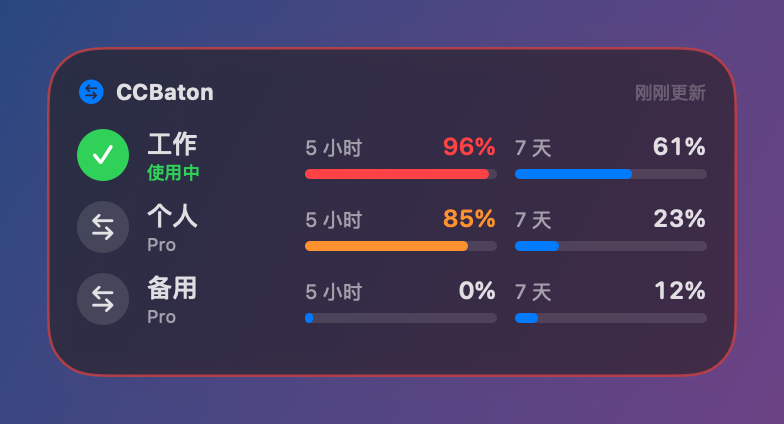<br><sub><b>中号小组件</b></sub></td>
    <td align="center" valign="middle">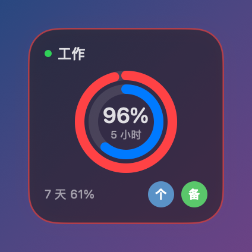<br><sub><b>小号小组件</b></sub></td>
  </tr>
</table>

**系统通知**：只提醒"使用中"的账号。5 小时和 7 天分开算，每个重置周期最多两次：用到 90% 一次，用完一次。通知里会告诉你多久后重置，并建议切到还有空的账号。可以在设置里关掉。第一次弹通知时，macOS 可能会问你要不要允许。

---

---

## Claude 桌面端

这是一个**实验功能，默认关闭**。装了 Claude 桌面应用（Claude.app）的话，在「设置 → 通用」里会多一个「管理 Claude 桌面端账号」的总开关；打开以后，每张账号卡片底部才会多一行，管理这个账号在**桌面端**的登录。没装桌面应用的人看不到这个开关；开关关着时，CCBaton 不会读写桌面端的任何文件，界面里也没有任何桌面端的东西。

桌面端和 Claude Code 是两套互相独立的登录，所以它不能直接借用终端的登录，每个账号要在桌面端**登录一次**，之后切换就不用再登录。额度是账号级别的（Claude、Claude Code、Cowork 共用同一份），所以额度条本来就包含了桌面端的用量，桌面端不另外显示额度。

<p align="center">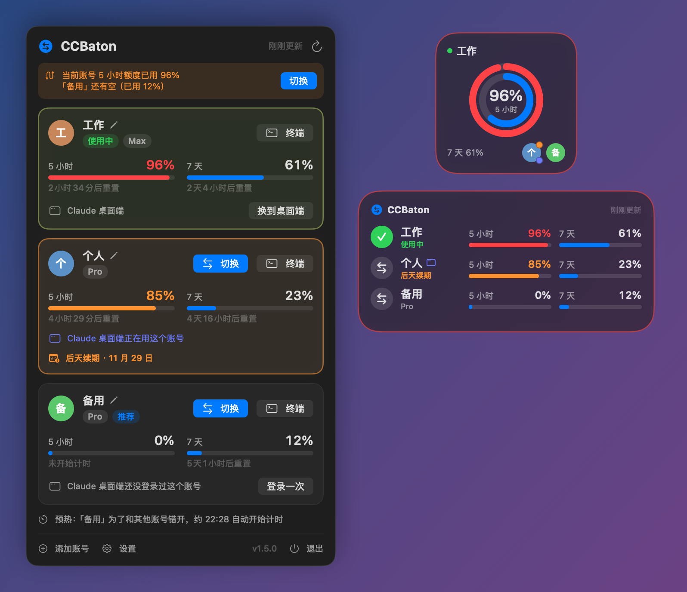<br><sub>桌面端正在用「个人」；「工作」已保存过登录，点"换到桌面端"一键切；「备用」还没登录过，点"登录一次"。右边的小组件上，「个人」带一个靛蓝色标记</sub></p>

卡片底部这一行有几种状态：

- **Claude 桌面端正在用这个账号**：不用做什么。
- **换到桌面端**：这个账号保存过桌面端登录，点一下换过去。
- **登录一次**：还没登录过。点了以后 CCBaton 先把桌面端现在登录的账号保存起来，打开登录界面，请你用卡片上这个账号的邮箱登录；登录好以后自动保存（保存时 Claude 会**自动退出再重开一次**，因为文件必须是完整的才能保存），并**核对登的是不是这个账号**：登错了会告诉你，可以改存给登录的那个账号（要它在 CCBaton 里），不会把错的登录存到这个账号名下。等待期间面板上有"取消并恢复"，随时可以退回原来的登录。
- **保存**：桌面端现在登录的就是这个账号，但还没保存过，点一下保存。

<p align="center"><br><sub>登录等待中：提示条上有"取消并恢复"</sub></p>

**小组件和右键菜单**：桌面端在用的账号，在桌面小组件上会带一个很小的靛蓝色标记（头像右下角的圆点，或名字后面的小图标），只是让你扫一眼知道桌面端现在是谁，**不能点**——小组件一直放在桌面上，换桌面端账号要退出 Claude，不想让你误点。要换的话，右键小组件，或右键菜单栏图标，里面有「桌面端」子菜单，列出每个账号：在用的打勾（灰的），已保存的点一下「换到 XX」，还没登录过的「在桌面端登录一次…」。

**换桌面端账号时会发生什么**：先让 Claude **正常退出**（不强杀；退不掉就什么都不改，并告诉你原因）→ 把现在登录的账号存回它自己名下（令牌会刷新，所以要先存）→ 写入目标账号的登录 → 重新打开 Claude。**正在进行的对话会被打断**，所以 Claude 开着时点之前会先问你。每次改动前都备份，写完核对，不对就回滚；备份只留一份，成功就删。

**存了什么、存在哪里（请读一下）**：桌面端的登录就是它数据目录里 `config.json` 的三个键加网页登录用的 `Cookies` 文件。CCBaton 把它们原样复制到 `~/Library/Application Support/ClaudeAccountBar/desktop/<账号>/`，文件权限只有你自己能读（0600）。令牌是 Claude 自己加密后的密文，CCBaton 不解密、不联网。**这是 CCBaton 自己的文件里唯一存着令牌（加密副本）的地方**，终端那边的令牌仍然只在钥匙串里。安全程度和 Claude 自己存这些文件的方式相当，但不如钥匙串；移除账号时会一并删掉它的这份，也可以直接删掉整个 `desktop` 文件夹。这一项和 Anthropic 条款里「开发者不得存储会话令牌」那句最接近，详见[合规与风险说明](compliance.md)。

**对话列表同步（子开关，默认关）**：桌面端 Code 标签侧边栏的对话列表按账号分开存，不处理的话，换号后看不到原来账号的对话。总开关打开后，设置里还有一个子开关「同步各账号的对话列表」，**默认关闭**——有人希望各账号的对话各管各的（比如工作号和个人号分开用，不想让工作号的对话标题和目录出现在个人号里）。打开它之后，换桌面端账号时（Claude 已经退出），CCBaton 会把其他账号的列表记录补进目标账号的目录，换号后侧边栏还能看到所有对话。**注意：复制是不可逆的**，已经复制过去的记录，之后关掉开关也不会删除。对话的内容本身在 `~/.claude/projects` 里，所有账号共用，不用复制。
- 只**补缺和刷新**（对方那份最近活动更晚才刷新），**从不删除**；已经删除的对话留下的 `deleted_` 记号会被尊重，不会再复制回来。
- 限制：这些记录里可能带账号专属的设置（比如连接器），原样复制过去，到别的账号里可能不可用；删除记号的格式是按别的项目的说明写的，还没有在真实的删除上验证过。
- **在别的账号下接着聊同步过来的对话**，Claude 会提示「Claude can't use thinking from another organization」，原因和影响见上面[切换是怎么回事](#切换是怎么回事请读一下)第 1 条：对话没丢，只是要重新思考，会慢一点、多用一点额度。想省额度，就回到开始这个对话的账号里接着聊。

**不做的**：
- **Claude 标签里的聊天和项目**：它们在 Anthropic 的服务器上、按账号分开，CCBaton 不碰。换桌面端账号后，Claude 标签里看到的是新账号自己的聊天，不是丢了。
- **桌面端的定时任务**：Code 标签里的定时任务也按账号分开，暂时没有同步。
- **和终端联动**：点"切换"只换终端的账号，不会动桌面端。以后可能加一个默认关闭的联动开关。

**限制**：
- 它依赖桌面应用内部的文件结构，不是 Claude 公开的接口。应用更新后可能失效；失败时会明确提示并回滚，不会静默出错。
- 在作者的 Mac 上（Claude 桌面应用 6.28899.6），用两个账号来回切换验证过；别的版本没试过。
- 保存的登录可能过期（比如很久没用）；切过去发现要重新登录时，点"登录一次"重新存。
- 桌面端现在登录的账号如果不在 CCBaton 里，换走会丢掉那个登录，所以此时不会切；请先把它添加成账号（在终端里用它登录一次 Claude Code）。

---

## 打开终端

点账号卡片上的"终端"，先弹出这个窗口：

<p align="center">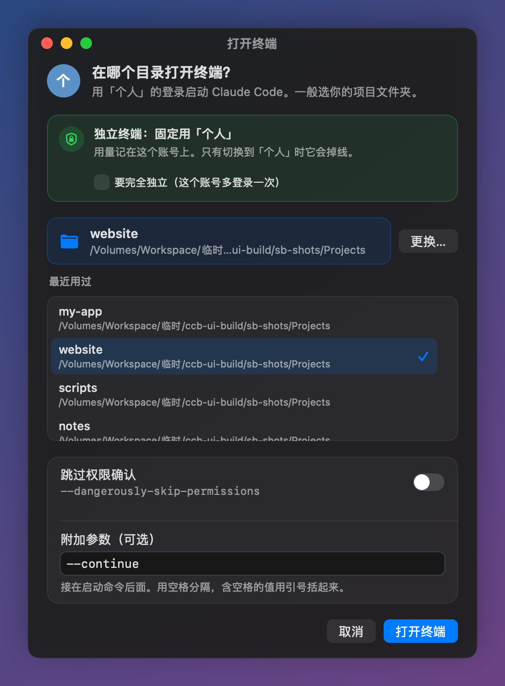</p>

- **选目录**：点"更换…"挑一个文件夹，或点"最近用过"里的一条（最多记 10 个，各账号共用；鼠标移上去可以删掉记录，不会删文件夹）。
- **各记各的**：每个账号记住自己上次用的目录、"跳过权限确认"和附加参数，下次点开直接按回车就行。
- **跳过权限确认**：勾上等于加 `--dangerously-skip-permissions`，Claude 改文件、执行命令都不再问你。勾选状态会记住，打开前留意一下。
- **附加参数**：比如 `--continue`、`--model opus`。按空格分开，含空格的值用引号括起来；参数原样传给 `claude`，不会被终端当成别的命令执行。`--settings` 不能填，它会破坏账号隔离。
- **工作环境是共用的**：agents、skills、命令、插件、`CLAUDE.md`、设置和对话记录都链接到你的 `~/.claude`，默认配置里的 MCP 服务器也会带过去，所以换个账号可以用 `claude --resume` 接着聊。（从 cc-switch 导入的账号，目录归 cc-switch 管，见下面的说明。）

### 账号是怎么隔开的

默认**不用再登录**，沿用每个账号现有的登录（和 cc-switch 一样）。窗口顶部会说明当前是哪种情况：

| 情况 | 终端用哪份登录 | 之后切换账号时 |
|---|---|---|
| 账号没在使用 | 账号自己的 | 切到别的账号不受影响；**切到它本身时这个终端掉线** |
| 账号正在使用 | 默认位置的 | **跟着换号** |
| 勾了"要完全独立" | 终端专用的一份（多登录一次） | 完全不受影响 |

如果开着的终端会被某次切换影响，CCBaton 会先弹窗告诉你影响几个，由你决定（只认得出从 CCBaton 打开的终端）。

不管哪种情况，都会做这几层防护：

- **挡住别的接口**：终端配置（`.zshrc` 等）里的 API 密钥、接口地址、令牌、Bedrock / Vertex 开关会被清掉；用户设置和项目设置里的同类项（包括 cc-switch 换到第三方供应商写进去的）用 `claude --settings` 覆盖掉。**不改你的任何设置文件**。第三方顺带设置的模型名环境变量也一并忽略，要指定模型就在附加参数里写 `--model`。
- **核对账号**：启动前检查要用的那份登录确实是所选账号，不是就不启动。
- **例外**：公司下发的系统级管理设置优先级最高，如果它指定了接口，CCBaton 会拒绝打开终端。

"完全独立"第一次打开时在终端里走一次官方登录（浏览器授权，登录页预填好邮箱；授权成了别的账号不会启动），以后不用再勾。程序开着时每 12 小时给它续期一次（只查额度，不花额度）。每个项目第一次用它打开时 Claude 会问一次是否信任。

从 cc-switch 导入、还没[迁移](#从-cc-switch-迁过来)的账号，它的目录里有一份 cc-switch 生成的设置副本，CCBaton 不去改它。用默认方式（没勾"完全独立"）给这类账号开的终端读的是这份副本：你改了默认设置后，要 cc-switch 同步过才会带过去。迁移之后就改用默认设置了。

---

---

## 额度预热

**默认关闭，开启前请读完。**

Claude 的 5 小时额度要等你发出第一条消息才开始计时。几个账号平时闲着、要用时一起开始，就会差不多同时用完，然后一起等重置。开启预热后：

- 某个账号一空闲（没有在计时），CCBaton 就让 `claude` 给它发一条极短的消息（Haiku 模型，不带工具、插件和你的设置，不保存对话），倒计时随即开始。同时有几个空闲时，先激活 7 天额度剩得多的。
- **错开**（默认开）：两次激活至少隔 5 小时 ÷ 能预热的账号数。3 个账号就是 1 小时 40 分，排开之后每隔这么久就有一个账号重置。急着用某个账号时直接用就行，不受限制。
- 发之前会先重新读额度确认它真的空闲；发完一两分钟后再核对倒计时有没有开始。没成功的 30 分钟后重试，连续失败 3 次后 5 小时才试一次。读不到最新额度（比如断网）时不发。
- 7 天额度已用完、登录失效的账号不会发。[Ultra](#ultra-套餐没有-5-小时限制) 没有 5 小时窗口，也不参与预热。

现在轮到谁、几点激活，面板底部和设置窗口里都看得到。

**要知道的几点：**

1. **消耗额度**：每次约 630 token（按 API 价约 0.00013 美元），每个账号一天最多激活约 5 次。很少，但不是零。
2. **周额度不会变多**：能连续干活的时间长了，7 天额度也烧得更快。
3. **电脑睡眠或程序没开时不会激活**，唤醒后才补上。
4. **有账号风险**：Anthropic 的[消费者条款](https://www.anthropic.com/legal/consumer-terms)限制用脚本等自动方式访问服务（API 密钥或官方明确允许的情况除外），[Claude Code 法律页](https://code.claude.com/docs/en/legal-and-compliance)说订阅额度按"普通的个人使用"设定。这个功能走的是官方 `claude -p`，但官方没有明确说定时自动激活是否允许。是否开启请自己判断，风险自负。
5. 需要较新版本的 Claude Code（支持 `--safe-mode`）。

---

---

## 桌面小组件

在设置里打开"显示小组件"。

<table>
  <tr>
    <td align="center" valign="top">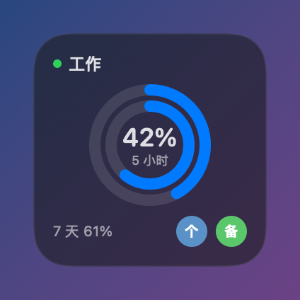<br><sub><b>小号</b><br>只看使用中的账号</sub></td>
    <td align="center" valign="top">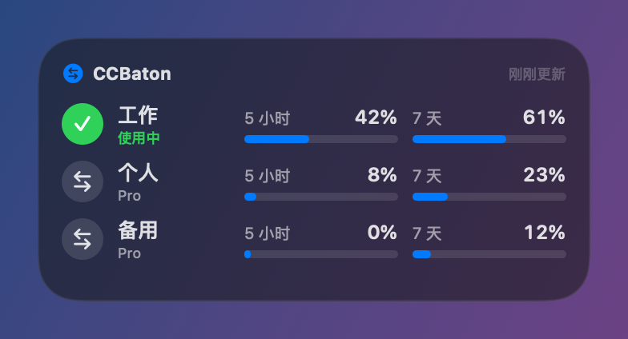<br><sub><b>中号</b><br>每个账号一行</sub></td>
    <td align="center" valign="top">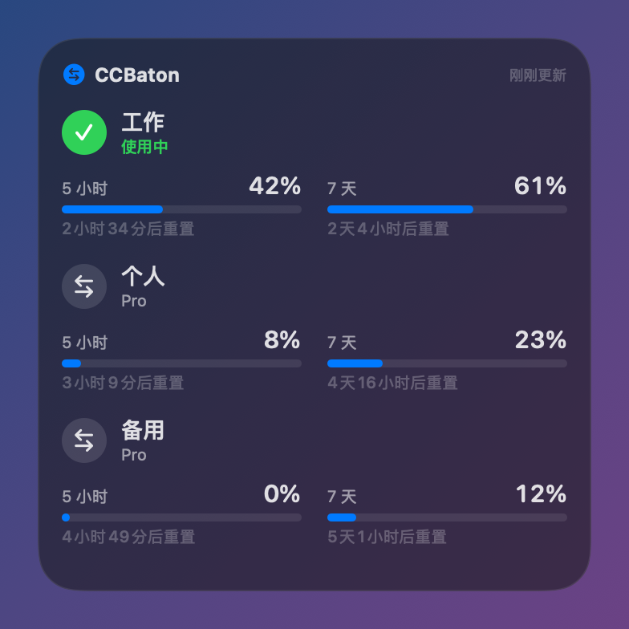<br><sub><b>大号</b><br>带重置倒计时</sub></td>
  </tr>
</table>

<p align="center">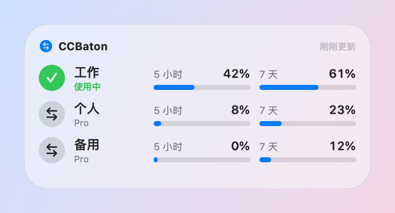<br><sub>浅色模式</sub></p>

- **切换账号**：中号和大号点账号前面的圆形按钮（灰色 = 点一下切换，绿色对勾 = 正在使用）；小号点右下角其他账号的头像。
- **换尺寸**：右键选"小号 / 中号 / 大号"，和系统小组件的尺寸一致。
- **拖动**：按住空白处拖，松手时自动吸附到系统小组件的格子上。位置和尺寸会记住。
- 右键还能"刷新额度"、打开"设置"和"隐藏小组件"。

**账号多的时候，小组件大小不变**，仍然对齐系统格子：

| 尺寸 | 原来的样子 | 账号更多时 | 还放不下时 |
|---|---|---|---|
| 小号 | 1～4 个 | 5 个起：两个头像加 "+N" | 点 "+N" 选 |
| 中号 | 1～3 个 | 4～6 个：两列排 | 7 个起：5 个加"还有 N 个" |
| 大号 | 1～3 个 | 4～8 个：每个一行（不显示重置时间） | 9 个起：7 个加"还有 N 个" |

放不下时按你排的顺序显示前几个；使用中的账号如果排在后面，会占最后一个位置，保证一直看得到。点"+N"或"还有 N 个"弹出菜单，选一个直接切换。

<p align="center">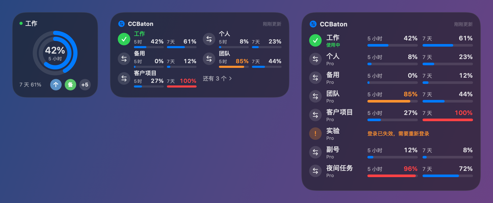<br><sub>8 个账号时的小号、中号、大号</sub></p>

---

---

## 设置窗口

面板底部点"设置"（小组件右键也能打开）。

<p align="center">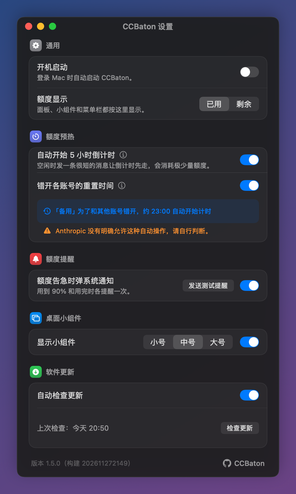</p>

| 分组 | 里面有什么 |
|---|---|
| 通用 | 开机启动、[额度显示](#已用还是剩余)（已用 / 剩余二选一，默认已用）、[管理 Claude 桌面端账号](#claude-桌面端)（默认关，只在装了桌面应用时出现）；装着 cc-switch 且有账号还没导入时，多一行"导入在 cc-switch 里登录的账号" |
| 账号文件位置 | 只在有账号的文件还在 cc-switch 目录里时出现：[迁移到 CCBaton](#从-cc-switch-迁过来) |
| 额度预热 | 总开关、错开重置时间、当前状态 |
| 额度提醒 | 系统通知开关、发送测试提醒 |
| 桌面小组件 | 显示 / 隐藏、尺寸 |
| 软件更新 | 自动检查开关、检查更新、更新到新版本，见[软件更新](#软件更新) |

名字旁边带 ⓘ 的项，点一下能看详细说明（比如预热的错开间隔怎么算）。窗口最底部左边是版本号，右边的 GitHub 图标加"CCBaton"点开本项目的开源仓库。

**开机启动**用的是 macOS 正规的登录项，在"系统设置 → 通用 → 登录项"里也能看到、能关。

- 请先把 `CCBaton.app` 放进"应用程序"文件夹再开启。放在外接盘或下载文件夹里的话，开机时那个位置可能还没准备好，会悄悄启动失败。
- 第一次开启时，系统可能会弹一条"已添加登录项"的提示，或者要你到"系统设置 → 通用 → 登录项"里点一下允许。

---

---

## 软件更新

<table>
  <tr>
    <td align="center" valign="top" width="50%">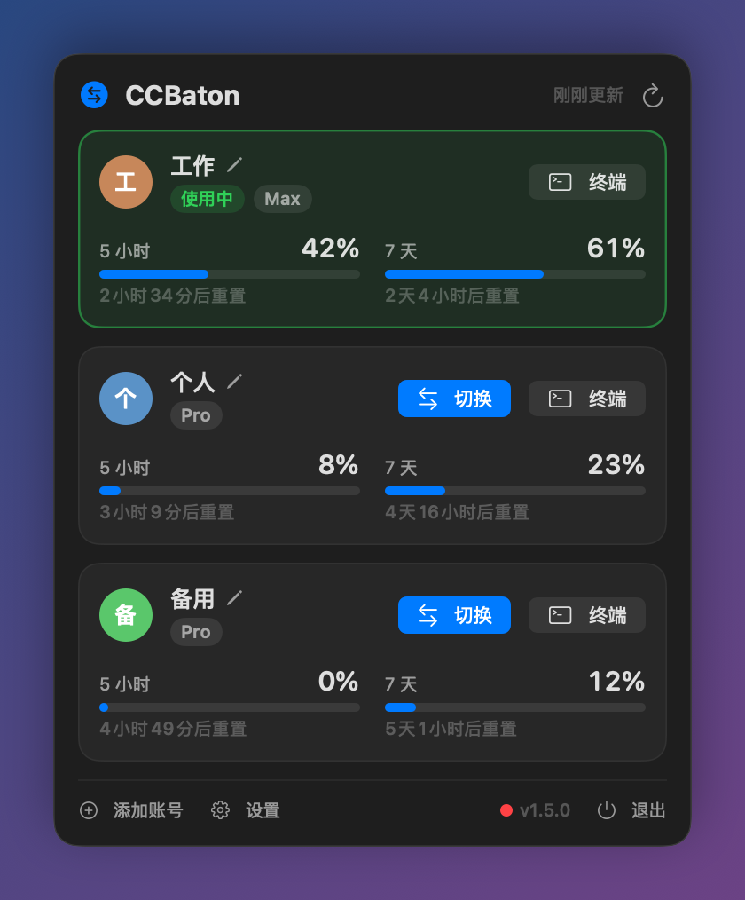<br><sub><b>有新版时版本号前亮红点</b></sub></td>
    <td align="center" valign="top" width="50%">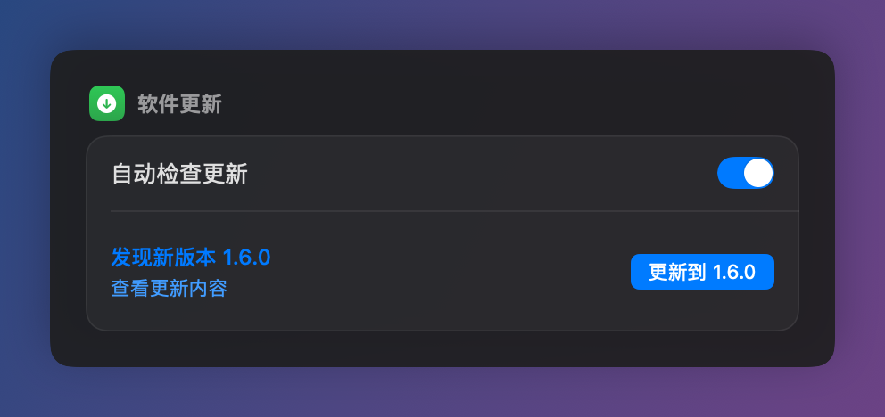<br><sub><b>设置里一键更新</b></sub></td>
  </tr>
</table>

- **自动检查**（默认开）：开机后查一次，之后每天最多一次；没查成（比如刚开机没网）10 分钟后再试。也可以随时点"检查更新"。
- **更新**：点"更新到 x.x.x"后才下载安装，不会自己偷偷装。下载 → 核对签名和版本号 → 退出 → 换上新版 → 重新打开。账号和设置不受影响。
- **装坏了会退回**：新版一分钟内没有启动起来，自动换回旧版。
- **安全**：只安装用本项目发布钥匙签过名的安装包，下载地址只认 github.com。签名对不上、版本号对不上、或比现在旧，都不装。
- 软件要放在"应用程序"里才能更新（直接从 DMG 里打开的不行）。连不上 GitHub 时可以点"打开下载页面"手动装。

---

---

## 账号管理

- **添加账号**：面板底部点"添加账号"，名字可填可不填 → 点"在终端里登录"，走 Claude 官方的登录流程，在浏览器里授权 → 授权完回到菜单栏点刷新。
- **导入 cc-switch**：见[从 cc-switch 迁过来](#从-cc-switch-迁过来)。
- **重新登录**：登录失效的账号，卡片上会出现"重新登录"按钮。
- **调整顺序**：拖动，或右键"上移 / 下移 / 移到最前"。面板和小组件都按这个顺序排。
- **编辑账号**：点名字旁边的铅笔（或右键账号选"编辑账号…"）。上面是这个账号真实登录的 Claude 信息，下面可以填显示名称（比如"工作""个人"，留空就显示邮箱）、每月续期日和备注。不会改动真实登录。

<p align="center">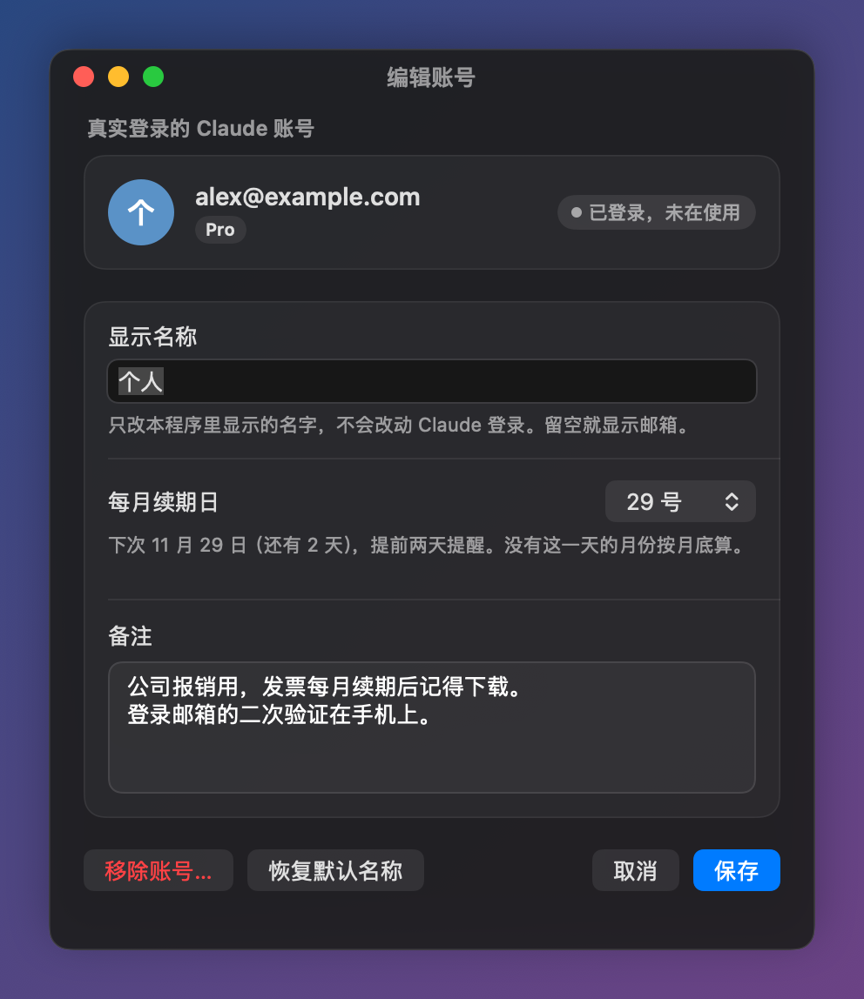</p>

### 续期提醒和备注

- **每月续期日**：默认"不提醒"。选了几号之后，到期前两天起提醒（后天续期 → 明天续期 → 今天续期），过了当天自动轮到下个月。那个月没有这一天（比如 2 月选了 31 号）按月底算。
- **提醒在哪里**：面板的账号卡片底部显示"后天续期 · 几月几日"，紧凑布局里写在名字下面；小组件上账号名下面或旁边显示橙色文字，小号小组件里其他账号的头像带一个橙点。
- 只是按你填的日期提醒，CCBaton 不知道实际有没有续费，也不弹系统通知。
- **备注**：自己随便写（比如付款方式、用途），回车换行，点"保存"后存下来，只保存在这台电脑上。

### 移除账号

右键账号选"移除账号…"，或点铅笔后按左下角的按钮。使用中的账号不能移除，先切换到别的账号。

移除就是**彻底移除**，不管这个账号是怎么加进来的。确认前会弹一个警告框（取消键是 Esc，回车不会触发移除）：

<p align="center">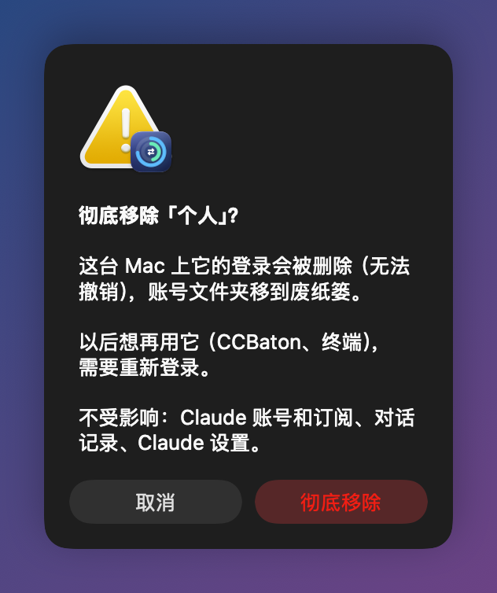</p>

| 内容 | 怎么处理 |
|---|---|
| 钥匙串里它的登录（含备份副本和"完全独立"终端那份） | 删除，**无法撤销**，以后要用得重新登录 |
| 它的账号文件夹 | 移到废纸篓 |
| cc-switch 记录里它那一条（导入的账号） | 删掉这一条，改之前把原清单备份到本程序数据目录的 `backups/` |
| cc-switch 的数据库 | 不动 |

对话记录、技能、Claude 设置（链接到 `~/.claude` 的那些）、Claude 账号和订阅都不受影响。

> 导入的账号和 cc-switch 共用同一份登录：在这里移除，cc-switch 里也会失效。还在用 cc-switch 的话，请先退出它再移除；它的数据库里可能留下一个指向空账号的条目。

---

## 从 cc-switch 迁过来

分两步，都在设置窗口里。相关入口只在需要时出现：没装 cc-switch、或账号已经迁完，界面里就不显示它。

1. **导入**：点"导入在 cc-switch 里登录的账号"。这一步只登记账号目录，不复制任何令牌，两个工具共用同一份登录。
2. **迁移**（可选，想让账号由 CCBaton 单独管理时做）：先退出 cc-switch，再点"迁移到 CCBaton"。登录和账号文件搬进 CCBaton 自己的目录，**不用重新登录**，迁走的账号在 cc-switch 里不再出现。

<table>
  <tr>
    <td align="center" valign="top" width="50%">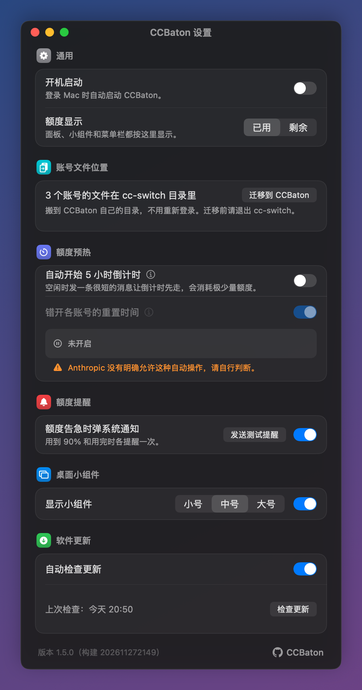<br><sub><b>入口</b></sub></td>
    <td align="center" valign="top" width="50%">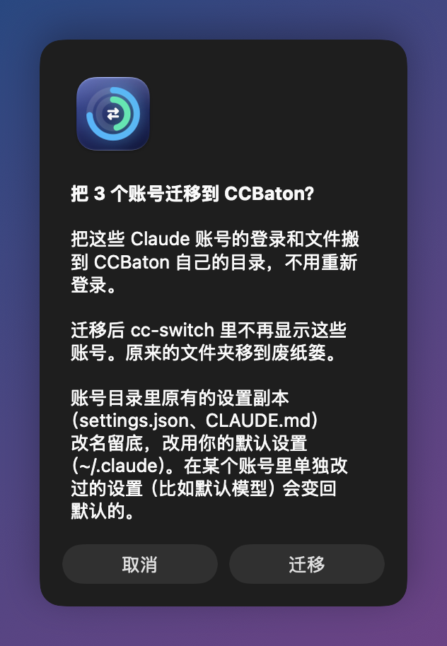<br><sub><b>确认框</b></sub></td>
  </tr>
</table>

迁移时做了什么：

- 先把账号目录和钥匙串里的登录**复制**到新位置并读回核对，账号列表确认写进磁盘后，才删掉旧的。中途任何一步失败，复制出来的撤掉，旧的原样不动；中途断电，下次启动自动收尾。
- 账号的名字、顺序、颜色、终端偏好、命令历史都保留。
- cc-switch 的账号记录里删掉迁走的条目（改之前备份），旧账号文件夹移到废纸篓。cc-switch 的数据库不动。
- 账号目录里原有的 `settings.json`、`CLAUDE.md` 副本改名为 `*.from-cc-switch` 留底，改用你 `~/.claude` 里的默认设置。**在某个账号里单独改过的设置（比如默认模型）会变回默认的。**

这些情况下不会开始迁移，会告诉你原因：cc-switch 还开着、有终端或别的程序正在用这些账号目录、CCBaton 正在切换或读额度。

---

---

## 切换是怎么回事（请读一下）

Claude Code 同一时间只认一个登录。CCBaton 的做法和 cc-switch 一样：

- 每个账号有自己的目录和钥匙串条目，"正在使用"的那个账号的登录放在 Claude Code 默认读的位置。
- 点"切换"时，把目标账号的登录**移**进默认位置，原来的账号收回它自己的位置。Claude Code（终端）的登录令牌始终只在 macOS 钥匙串里，用系统自带的 `security` 命令搬动，**CCBaton 自己的文件里不存终端的令牌**。（唯一的例外是可选的[桌面端账号切换](#claude-桌面端)：它存的是 Claude 桌面应用自己加密过的登录副本，文件权限 0600。）
- 为了安全：搬动前会拿 Claude Code 自己的刷新锁、每次写入后读回核对、写之前确认没被 Claude Code 改动过；任何一步失败就取消，不留半截状态。切换前还会把原来的整份登录备份到钥匙串（条目名 `ClaudeAccountBar-backup`，每次覆盖）。

**要知道的几点：**

1. 正在运行的普通 `claude`（包括跟着默认登录的终端）会在**下一条消息**换成新账号，提示缓存要重建，第一条会慢一点、多用一点额度。接着聊的是**另一个账号开始的对话**时，Claude 还会提示「Claude can't use thinking from another organization」（无法使用来自另一个组织的思考内容）：这是 Claude 自己的行为，[官方文档](https://platform.claude.com/docs/en/build-with-claude/preserved-thinking)写明思考内容只在产生它的账号（或关联账号）里有效，换到别的账号会被丢掉。对话没有丢，也没有出错，只是 Claude 要重新读一遍对话、重新思考，下一次回复会慢一点、多用一点额度；切回原来的账号再接着聊，思考内容就又能用了。
2. 从"终端"按钮开的终端可能受切换影响（见[账号是怎么隔开的](#账号是怎么隔开的)），受影响时会先提醒你。
3. **不要同时在 cc-switch 里点"启用"**，两个工具一起搬登录会打架。
4. 没在使用的账号，登录大约 7～8 天到期。程序开着时会定期让 Claude 自己刷新，通常能续上；长期不开程序可能过期，过期了卡片会提示，点"重新登录"即可。
5. **关于条款和风险**：同时用自己名下的多个订阅，Claude Code [官方认证文档](https://code.claude.com/docs/en/authentication)是明确支持的（每个账号一个独立的 `CLAUDE_CONFIG_DIR`，「终端」按钮就是这个做法）。但这里的「切换」（把登录搬进默认位置）、额度预热、桌面端账号切换，官方文档没有专门讲到，属于灰色地带，cc-switch 自己也这么说。**没有任何工具能保证不封号。** 条款怎么说、CCBaton 逐条怎么做、哪些默认关闭、怎样只用官方写明的方式，都写在 **[合规与风险说明](compliance.md)** 里，请读一下。多个账号请都是你自己的订阅。CCBaton **不做自动轮换**，每次切换都是你主动点的（唯一会自动发消息的是默认关闭的[额度预热](#额度预热)）。

---

---

## 数据在哪里

| 内容 | 位置 |
|---|---|
| 设置（账号列表和顺序、名字、续期日、备注、头像颜色、小组件位置和尺寸、告警开关、预热开关和记录、最近目录和启动参数） | `~/Library/Application Support/ClaudeAccountBar/accounts.json` |
| 账号列表的备份（内容和上一行相同）。列表文件坏了会自动用它恢复，坏文件另存为 `accounts.json.broken-…` 并弹窗告诉你 | `~/Library/Application Support/ClaudeAccountBar/accounts.json.bak` |
| 新加账号的目录 | `~/Library/Application Support/ClaudeAccountBar/accounts/` |
| 终端（Claude Code）的登录令牌 | macOS 钥匙串（`Claude Code-credentials…`），**不在文件里** |
| 桌面端的登录（每个账号一份：三个登录键 + Cookies，Claude 自己加密过的密文，权限 0600；只有用了[桌面端切换](#claude-桌面端)才有） | `~/Library/Application Support/ClaudeAccountBar/desktop/` |
| 桌面端改动前的备份（只留一份，成功就删） | `~/Library/Application Support/ClaudeAccountBar/desktop-backup/` |
| "完全独立"终端的目录 | `~/Library/Application Support/ClaudeAccountBar/terminals/` |
| 切换前的备份 | 钥匙串条目 `ClaudeAccountBar-backup` |
| 上面那份备份属于哪个账号（只记账号编号，不含令牌） | `~/Library/Application Support/ClaudeAccountBar/backup-owner` |
| 从 cc-switch 导入的账号 | 迁移前仍在 `~/.cc-switch/claude-accounts/`（只登记路径，没复制）；迁移后和新加的账号放在一起 |
| 移除或迁移账号时备份的 cc-switch 记录（不含令牌） | `~/Library/Application Support/ClaudeAccountBar/backups/` |
| 更新时下载的安装包和记录（更新成功后清掉安装包） | `~/Library/Application Support/ClaudeAccountBar/update/` |

> 数据目录名保留了旧名字 `ClaudeAccountBar`，是为了改名时不用搬家。

CCBaton 自己只在检查和下载更新时联网（访问 GitHub，请求里只带软件名和版本号；自动检查可以在设置里关掉），不收集、不上传任何账号数据。查额度（以及开启后的预热消息）的网络请求是 Claude 自己发的。

---

## 出问题怎么办

- **切换时提示钥匙串超时**：系统可能弹了一个钥匙串授权窗，点"始终允许"后再试。没切成功时默认登录是原样不动的。
- **卡片提示"登录已失效"**：点"重新登录"，在终端里完成授权。
- **切换后 `claude` 说没登录**：先在终端运行 `claude auth login` 重新登录，最省事。切换前的整份登录备份在钥匙串条目 `ClaudeAccountBar-backup` 里（用"钥匙串访问"app 能看到）。
- **从"终端"按钮开的终端说没登录**：多半是之后切换到了这个账号，登录搬到默认位置了。关掉它，重新点"终端"。
- **终端提示"没有启动 claude"**：开窗口到启动之间登录变了，或"完全独立"授权成了别的账号。按终端里的说明处理后再点一次。
- **看不到小组件**：打开设置里的"显示小组件"。如果你有多个显示器，它可能在另一块屏幕上。
- **额度显示"—"或"暂无数据"**：点刷新，等几秒。
- **预热状态显示"上次没成功"**：在终端运行 `claude --version` 确认 Claude Code 是新版本，并确认这个账号能正常使用。
- **导入的账号突然都失效了**：没[迁移](#从-cc-switch-迁过来)的账号文件放在 `~/.cc-switch` 里，这个文件夹被删除或移动后就读不到了，需要重新添加账号。
- **迁移提示"有正在运行的程序在用"**：把别处打开的 `claude`（比如从 cc-switch 开的终端）关掉再试。
- **更新没成功**：设置里"软件更新"会说明原因；脚本的记录在上面 `update/` 目录的 `install.log`。也可以到下载页面手动装。
- **想彻底卸载**：先在设置里关掉"开机启动" → 退出程序 → 删除 `CCBaton.app`（自己编译的删源码文件夹）和上面的数据目录。钥匙串里的登录不会被删（它们本来就是 Claude 的登录）。

---
